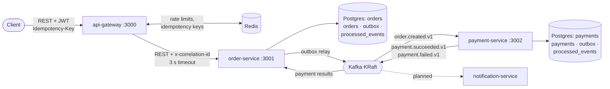

# ShopFlow

A small, event-driven e-commerce backend built with NestJS microservices: place an order,
pay for it (simulated), and get notified. It exists to demonstrate industry-standard
microservice patterns: API gateway (JWT, rate limiting, idempotency keys, correlation IDs),
transactional outbox, idempotent consumers, choreography saga, retry and dead-letter
topics, database-per-service.

- Interview guide (patterns, trade-offs, Q&A): [docs/INTERVIEW.md](docs/INTERVIEW.md)
- Product requirements: [docs/PRD.md](docs/PRD.md)
- Architecture and diagrams: [docs/ARCHITECTURE.md](docs/ARCHITECTURE.md)
- Decisions (ADRs): [docs/decisions](docs/decisions)
- Learning notes: [docs/learning](docs/learning)

## Architecture



| Service              | Status  | Responsibility                                                      |
| -------------------- | ------- | ------------------------------------------------------------------- |
| api-gateway          | working | JWT auth, routing + timeouts, rate limiting, idempotency keys       |
| order-service        | working | Orders REST API, Postgres (Prisma), outbox, applies payment results |
| payment-service      | working | Consumes `order.created`, simulates a charge, publishes the result  |
| notification-service | planned | Consumes payment results, sends notifications (#14)                 |

## Quick start

Requirements: Node.js 26 (see `.nvmrc`), pnpm 12, Docker. Bash (Git Bash on Windows).

```bash
pnpm install
cp .env.example .env          # local placeholders; set a real JWT_SECRET (openssl rand -base64 48)
docker compose up -d postgres postgres-init kafka kafka-init kafka-ui redis
                              # Postgres (+ payments DB/role), Kafka (+ topics), UI :8080, Redis
pnpm prisma:deploy && pnpm prisma:deploy:payment   # apply both services' migrations
pnpm start:order              # http://localhost:3001/health
pnpm start:payment            # http://localhost:3002/health
pnpm start:gateway            # http://localhost:3000/health (NODE_ENV=development for dev tokens)
```

## Demo script

Run in one Bash shell, everything through the gateway. Every command below was run
against the real stack before it went into this README.

```bash
json() { node -pe "JSON.parse(require('fs').readFileSync(0)).$1"; }
GW=localhost:3000
TOKEN=$(curl -s -X POST $GW/auth/token -H 'content-type: application/json' \
  -d '{"sub":"c-1"}' | json accessToken)                 # dev-only token endpoint
order() { # $1 = Idempotency-Key, $2 = unit price in cents
  curl -s -X POST $GW/orders -H "authorization: Bearer $TOKEN" \
    -H 'content-type: application/json' -H "idempotency-key: $1" \
    -d "{\"customerId\":\"c-1\",\"currency\":\"EUR\",\"items\":[{\"sku\":\"BOOK-1\",\"quantity\":1,\"unitPriceCents\":$2}]}"
}
status() { curl -s $GW/orders/$1 -H "authorization: Bearer $TOKEN" | json status; }
```

**1. Both saga outcomes.** Orders above `PAYMENT_DECLINE_ABOVE_CENTS` (default 1000.00) are
declined:

```bash
PAID_ID=$(order "demo-$RANDOM-a" 2500 | json id)      # 25.00   -> PAID
FAIL_ID=$(order "demo-$RANDOM-b" 150000 | json id)    # 1500.00 -> PAYMENT_FAILED
sleep 4; status $PAID_ID; status $FAIL_ID              # PAID, PAYMENT_FAILED
```

**2. Idempotent retry.** Same key, same body → the first order comes back
(`Idempotent-Replayed: true`); same key, different body → 422:

```bash
KEY=demo-$RANDOM-c
order $KEY 2500 | json id; order $KEY 2500 | json id   # same id twice
order $KEY 9999                                          # 422 IDEMPOTENCY_KEY_REUSED
```

Watch `order.created.v1` and `payment.*.v1` in Kafka UI (http://localhost:8080).

## Failure demos

**Kafka down: the outbox keeps accepting orders.** The order and its event row commit in
one transaction; the relay publishes once Kafka is back (~30-40 s locally).

```bash
docker compose stop kafka
ID=$(order "outage-$RANDOM" 2500 | json id); sleep 3; status $ID   # PENDING
docker compose start kafka
sleep 40; status $ID                                               # PAID
```

**payment-service down: the consumer catches up.** Stop it (Ctrl+C), create an order (stays
`PENDING`), restart `pnpm start:payment`: it resumes from its committed offset and the
order becomes `PAID` (~20 s).

**Poison message → dead-letter topic.** Unparseable events are permanent failures: no
retries, straight to `order.created.v1.dlq`, and the consumer keeps going:

```bash
echo '{not json' | MSYS_NO_PATHCONV=1 docker exec -i shopflow-kafka \
  /opt/kafka/bin/kafka-console-producer.sh --bootstrap-server localhost:9092 --topic order.created.v1
# payment-service log: "sent to order.created.v1.dlq (permanent) after attempt 1"
```

**Edge failures at the gateway** (all answer RFC 9457 problem+json with `correlationId`):

| Do this                                            | Then                                                                                                                               |
| -------------------------------------------------- | ---------------------------------------------------------------------------------------------------------------------------------- |
| call `/orders` without `authorization`             | 401 + `WWW-Authenticate: Bearer`                                                                                                   |
| stop order-service, call `/orders`                 | 502 `BAD_GATEWAY` (no hang)                                                                                                        |
| start the gateway with `RATE_LIMIT_MAX=5`, call 6× | 429 + `Retry-After` by the 6th call at the latest (counters live in Redis, so the same user's earlier calls this minute count too) |
| `docker compose stop redis`, then `POST /orders`   | 503 + `Retry-After: 5` (fail closed); `GET` works                                                                                  |

## Scripts

| Command             | What it does                                           |
| ------------------- | ------------------------------------------------------ |
| `pnpm lint`         | ESLint (typescript-eslint type-checked), zero warnings |
| `pnpm format:check` | Prettier check                                         |
| `pnpm typecheck`    | `tsc --noEmit` over apps and libs                      |
| `pnpm test`         | Unit tests (`*.spec.ts` under `src/`)                  |
| `pnpm test:e2e`     | E2E tests with Supertest (`apps/*/test/*.e2e-spec.ts`) |
| `pnpm build`        | Builds every app into `dist/`                          |

## Layout

```
apps/api-gateway     Edge: JWT, proxy + timeouts, rate limiting, idempotency (Redis)
apps/order-service   Orders REST API + outbox + payment-result consumer (database: orders)
apps/payment-service Simulated payments (database: payments)
libs/contracts       Versioned event contracts shared by all services
libs/kafka           Producer/consumer wrappers around kafkajs (retry topics, DLQ)
libs/database        DB interface, readiness check, processed-events claim
libs/outbox          Outbox relay shared by every service
libs/errors          DomainError + RFC 9457 problem details + correlation ID rules
docs/                PRD, architecture, ADRs, learning notes, interview guide
```
