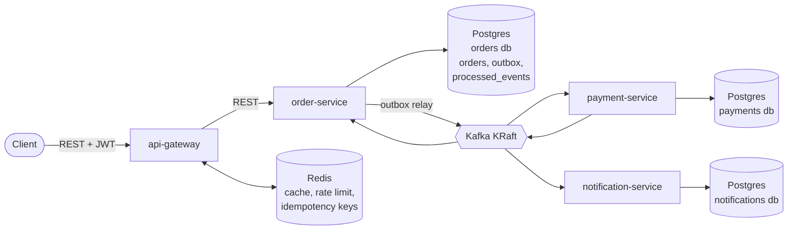
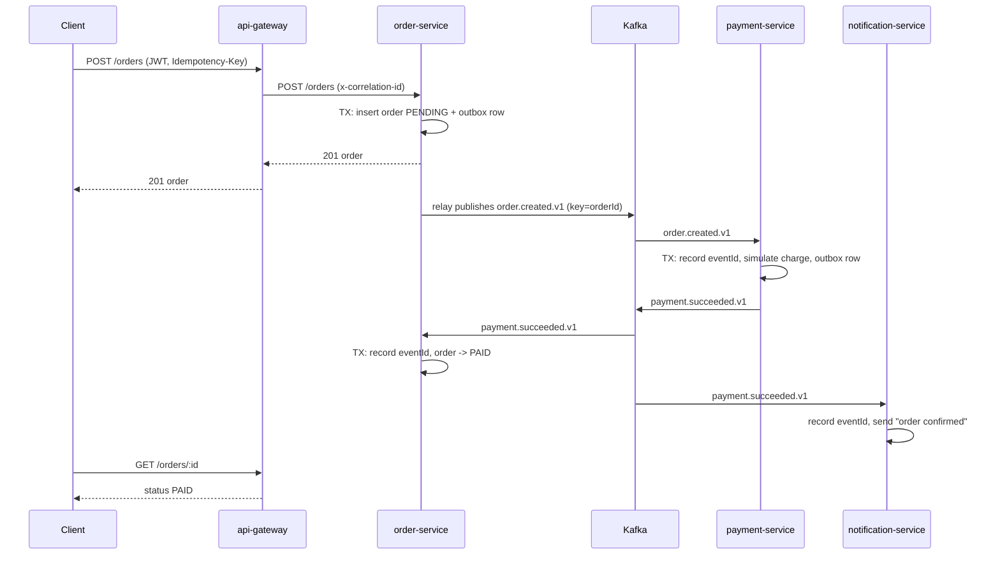
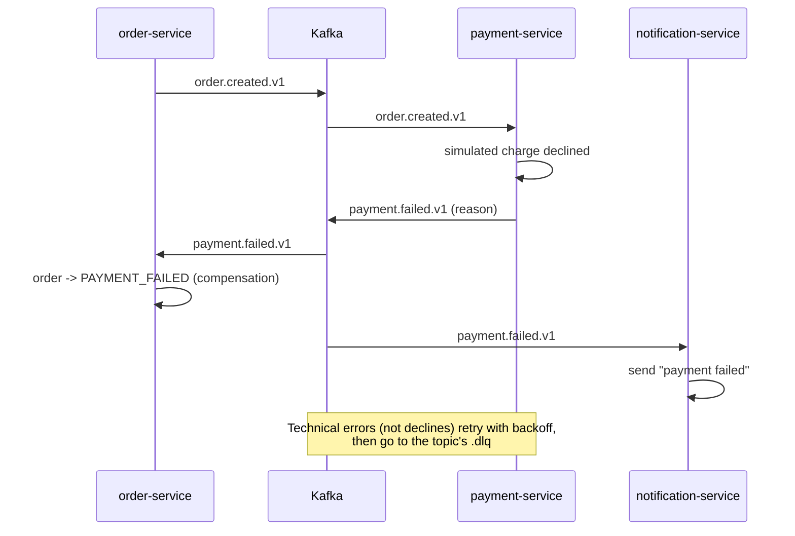

# ShopFlow Architecture

## Services and data stores

Each service owns its database (database-per-service). Locally they are separate databases
in one Postgres container; nothing reads another service's tables. Services talk to each
other only through Kafka events defined in `libs/contracts`.

## Saga: happy path

## Saga: payment failure

A declined payment is a business outcome and becomes an event. A crash or bug is a
technical failure: it is retried and, if it keeps failing, parked in the dead-letter topic.

## Kafka topics

| Topic                  | Key          | Producer                  | Consumers                           | Payload version |
| ---------------------- | ------------ | ------------------------- | ----------------------------------- | --------------- |
| `order.created.v1`     | `orderId`    | order-service (outbox)    | payment-service                     | v1              |
| `payment.succeeded.v1` | `orderId`    | payment-service (outbox)  | order-service, notification-service | v1              |
| `payment.failed.v1`    | `orderId`    | payment-service (outbox)  | order-service, notification-service | v1              |
| `<topic>.dlq`          | original key | the consumer that gave up | operator (Kafka UI)                 | same as source  |

Every message uses the envelope in `libs/contracts`: `eventId`, `type`, `occurredAt`,
`correlationId`, `payload`. Breaking changes create a new versioned topic (`.v2`) and run
both side by side during migration.

Payloads (zod schemas and fixtures in `libs/contracts/src`; consumers call `parseEvent`):

- `order.created.v1`: `orderId`, `customerId`, `totalCents`, `currency`,
  `items[{ sku, quantity, unitPriceCents }]`
- `payment.succeeded.v1`: `orderId`, `paymentId`, `amountCents`, `currency`
- `payment.failed.v1`: `orderId`, `reason`, `amountCents`, `currency`

## Order status

`PENDING` -> `PAID` or `PAYMENT_FAILED`. Transitions only from `PENDING`; a duplicate or
late event for a finished order is ignored and logged.

## Key decisions

See [decisions](decisions): stack (0001), KafkaJS directly (0002), NestJS gateway (0003),
kind (0004), Nest CLI monorepo (0005).
