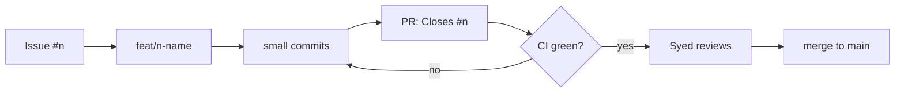

# 00. How we work

**In plain words.** Every change starts as a GitHub issue. We branch from `main`
(`feat/12-create-order`), make small commits with Conventional Commit messages
(`feat(order): add create endpoint`), push, and open a pull request that says `Closes #12`.
CI runs lint, format, typecheck, unit tests, e2e tests and build. Syed reviews and merges;
merging closes the issue. Big decisions go into a short ADR so the "why" survives.

**Monorepo layout.** One repo, one `package.json`, one lockfile.
`apps/<service>` holds a deployable NestJS app; `libs/contracts` holds event types that
every service imports as `@shopflow/contracts`. Services never import from each other.

| Concept          | Here                                     | .NET equivalent                        |
| ---------------- | ---------------------------------------- | -------------------------------------- |
| Monorepo         | Nest CLI `apps/` + `libs/`, pnpm         | One `.sln` with several projects       |
| Shared contracts | `libs/contracts` (`@shopflow/contracts`) | A shared class library / NuGet package |
| Package manager  | pnpm + `pnpm-lock.yaml`                  | NuGet + `packages.lock.json`           |
| Build            | `nest build` (tsc)                       | `dotnet build`                         |
| Lint / format    | ESLint + Prettier                        | Roslyn analyzers + `dotnet format`     |
| Unit / e2e tests | Jest + Supertest                         | xUnit + `WebApplicationFactory`        |
| Config           | `@nestjs/config` + schema                | `IOptions<T>` + `ValidateOnStart()`    |
| CI               | GitHub Actions `ci.yml`                  | Azure Pipelines / GitHub Actions       |
| ADR              | `docs/decisions/NNNN-*.md`               | Same practice, any stack               |

## Interview questions

1. **Why Conventional Commits?** They make history scannable and let tools generate
   changelogs and pick semantic version bumps (`feat` = minor, `fix` = patch, `!` = major).
2. **Monorepo vs polyrepo for microservices?** A monorepo makes shared contracts and atomic
   cross-service changes easy and keeps tooling consistent; a polyrepo gives teams
   independent release cadence and ownership. Microservices are about independent
   deployment, not separate repos: each app here still builds and deploys on its own.
3. **What belongs in CI before merge?** Fast, deterministic checks: lint, typecheck, unit,
   e2e and integration tests, build. They make `main` always releasable and catch problems
   while the author still has the context.
