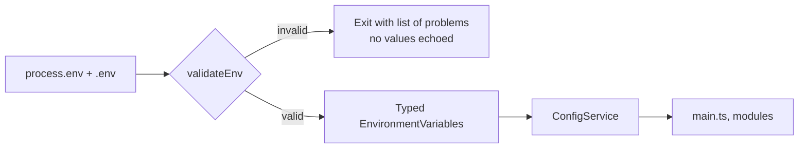

# 01. Configuration with fail-fast validation

**In plain words.** A service reads its settings (port, database URL, later Kafka brokers
and JWT secret) from environment variables, checks all of them once when it starts, and
refuses to start if anything is missing or malformed. After that, code asks a typed
`ConfigService` for values and never touches `process.env` directly.

**Why here.** 12-factor apps take config from the environment so the same image runs in
compose, CI and Kubernetes. The danger is that a typo only surfaces when the code path
first runs, maybe hours later under load. Validating at boot turns that into a crash at
deploy time, where the rollout stops and the old pods keep serving.

**Choices in ShopFlow.**

- `class-validator` + `class-transformer`: the same decorators we use for DTOs.
- `excludeExtraneousValues`: only declared keys survive, so the config object is exactly
  the schema.
- Error lists every problem in one go and never prints values (a DB URL holds a password).
- Real environment variables override `.env`, so containers and Kubernetes win over local
  files.

| Concept      | NestJS (ShopFlow)                           | .NET                                          |
| ------------ | ------------------------------------------- | --------------------------------------------- |
| Sources      | `process.env`, `.env`                       | `appsettings.json`, env vars, user secrets    |
| Typed access | `ConfigService<EnvironmentVariables, true>` | `IOptions<T>`                                 |
| Validation   | `validate` fn with class-validator          | DataAnnotations + `ValidateDataAnnotations()` |
| Fail fast    | validation inside `ConfigModule.forRoot`    | `.ValidateOnStart()`                          |

## Interview questions

1. **Why validate config at startup instead of at first use?** A rolling deploy then fails
   on the first new pod, readiness never goes green, and the old version keeps serving. A
   lazy failure ships the broken version and fails real requests later.
2. **Config vs secrets?** Both arrive as env vars at runtime, but secrets come from a secret
   store (Kubernetes Secret, Vault, cloud secret manager), are never committed, never
   logged, and are rotated. `.env.example` holds placeholders only.
3. **Why not read `process.env` anywhere you need it?** Values are untyped strings, there is
   no single list of what the service needs, and tests have to mutate global state. One
   validated, injected config object fixes all three.
