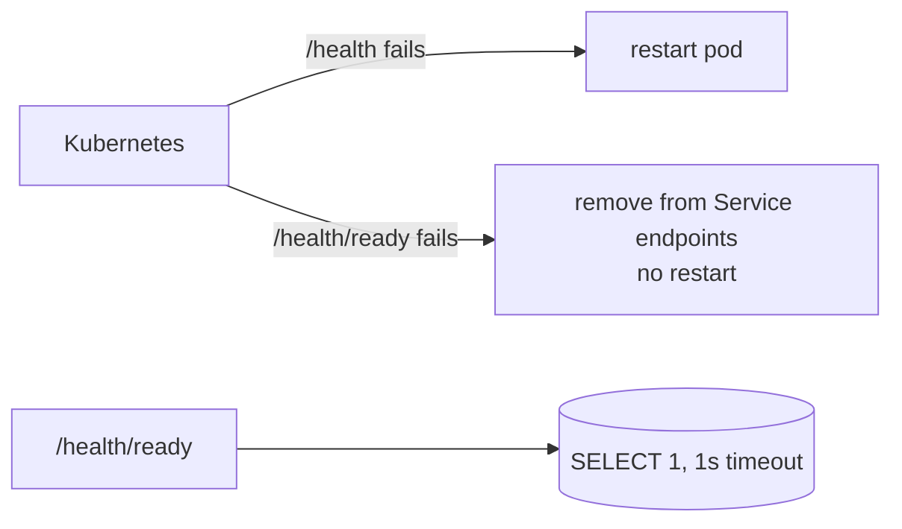

# 02. Persistence with Prisma, and liveness vs readiness

**In plain words.** order-service stores orders in its own Postgres database. The table
layout lives in `schema.prisma`; every change becomes a SQL migration file that is
committed and applied in order, on every environment. One class, `OrdersRepository`, talks
to the database about orders and hands the rest of the service plain, readonly `Order`
objects. Two health endpoints answer two different questions: `/health` means "is the
process alive?" and `/health/ready` means "can it serve traffic right now?"

**Why here.**

- **Migrations as code:** the schema is reviewed in PRs and replayed identically in CI,
  Docker and Kubernetes. No hand edits on a live database.
- **Constraints in the database:** `quantity > 0` and non-negative money are enforced by
  Postgres `CHECK`s that we added to the migration by hand (Prisma's schema can't express
  them). DTO validation protects the API; constraints protect the data from every path.
- **Money as integer cents:** `0.1 + 0.2 !== 0.3` in floating point; integers are exact.
- **Repository + domain types:** services never see Prisma types, so tests mock one small
  class and the ORM could change without touching business logic.
- **Liveness vs readiness:** if Postgres goes down, restarting order-service fixes nothing.
  Liveness stays 200 (no restart loop), readiness goes 503 and Kubernetes stops sending
  traffic until the database is back. We verified this by stopping Postgres.

| Concept         | ShopFlow (NestJS)                            | .NET                                                         |
| --------------- | -------------------------------------------- | ------------------------------------------------------------ |
| ORM             | Prisma 7 + pg adapter                        | EF Core + Npgsql                                             |
| Schema source   | `schema.prisma`                              | `DbContext` + entity classes                                 |
| Migrations      | `prisma migrate dev` / `deploy`              | `dotnet ef migrations add` / `database update`               |
| Raw constraints | hand-edited `migration.sql`                  | `migrationBuilder.Sql(...)` or `HasCheckConstraint`          |
| Lifetime        | `PrismaService` singleton, `onModuleDestroy` | `DbContext` scoped, pooled                                   |
| Health checks   | `@nestjs/terminus`                           | `AddHealthChecks().AddNpgSql()`, `MapHealthChecks` with tags |

## Interview questions

1. **Liveness vs readiness: what goes wrong if a DB check is in liveness?** During a DB
   outage every pod fails liveness and gets restarted, over and over. That adds load and
   cold starts but fixes nothing. Readiness just takes pods out of the load balancer.
2. **Why not let the ORM be your only validation?** Any other writer (a script, a future
   service version, a bug) bypasses application checks. Database constraints are the last
   line of defence and document invariants next to the data.
3. **Offset vs cursor pagination?** Offset is simple and supports "jump to page N" but gets
   slower with deep offsets and can skip or duplicate rows when data changes between pages.
   Cursor (keyset) pagination (`WHERE (created_at, id) < (...)`) is stable and fast, at the
   cost of no random page access. The stable `(createdAt, id)` ordering we use makes a later
   switch to keyset easy.
