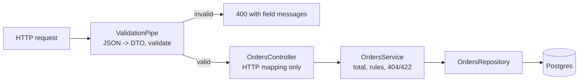

# 03. REST API with DTO validation

**In plain words.** Every request body and query string is turned into a DTO class and
checked against its decorators before the controller runs. Unknown fields are rejected,
not ignored. The controller only maps HTTP to a service call; `OrdersService` holds the
rules, such as computing the order total itself.

**Why here.**

- **No mass assignment:** `CreateOrderDto` has no `status` or `totalCents`. With
  `whitelist` + `forbidNonWhitelisted`, a client sending `"status": "PAID"` gets a 400
  instead of a free order. `whitelist` alone would silently drop it; rejecting tells the
  client its request was wrong.
- **Server-owned values:** the total is computed from the items; a client-sent total would
  be trusted data from an untrusted source. The service also rejects totals above the
  Postgres `INTEGER` limit rather than letting the insert fail with a 500.
- **Bounded inputs:** items 1-50, quantity 1-1000, `limit` at most 100, `offset` at most
  10,000. Every request has a worst-case cost we chose, not one the caller chose.
- **`APP_PIPE` instead of `useGlobalPipes`:** registered through DI, so the e2e tests (which
  build the app from `AppModule`) run the same validation as production.

| Concept               | ShopFlow (NestJS)                      | ASP.NET Core                                              |
| --------------------- | -------------------------------------- | --------------------------------------------------------- |
| Input model           | DTO class + class-validator decorators | Request record + DataAnnotations / FluentValidation       |
| Automatic 400         | global `ValidationPipe`                | `[ApiController]` model-state validation                  |
| Reject unknown fields | `forbidNonWhitelisted`                 | `JsonSerializerOptions.UnmappedMemberHandling = Disallow` |
| Route constraint      | `ParseUUIDPipe`                        | `{id:guid}`                                               |
| Query binding         | `@Query()` + `@Type(() => Number)`     | `[FromQuery]`                                             |
| Not found             | `throw new NotFoundException()`        | `return NotFound()`                                       |

## Interview questions

1. **Why never bind request bodies straight to entities?** Mass assignment: any column the
   entity has becomes writable by the client (status, price, owner). A DTO is an explicit
   allow-list of what a caller may set, and it decouples the API contract from the schema.
2. **What makes a controller "thin", and why bother?** It only translates HTTP to a service
   call and back. The rules then live in a class you can unit-test without HTTP and reuse
   from other entry points, such as a Kafka handler or a CLI.
3. **400 vs 404 vs 422?** 400: the request is malformed (fails validation, bad UUID). 404:
   it is well-formed but the resource does not exist. 422: well-formed and understood but
   violates a business rule (our total cap). Consistent codes let clients decide whether
   retrying or fixing input makes sense.
