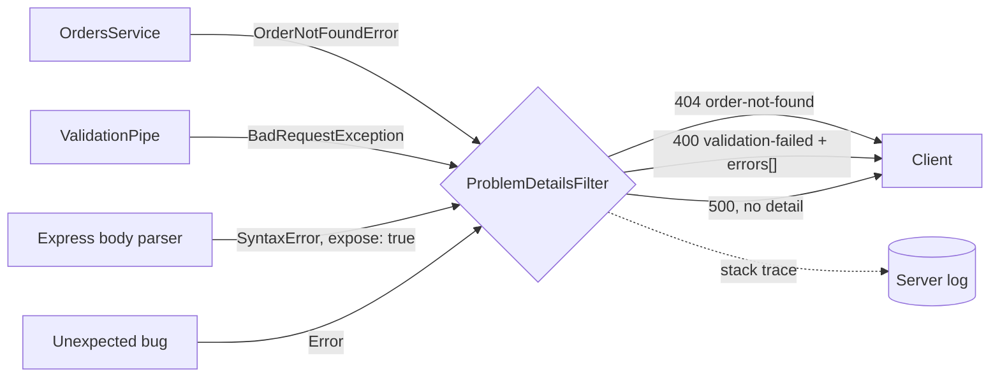

# 04. Error handling with domain errors and Problem Details

**In plain words.** Business code throws _domain errors_ ("order not found", "total too
large") that know nothing about HTTP. One global exception filter turns every error into
the same response format, RFC 9457 Problem Details (`application/problem+json`). Errors we
did not expect become a plain 500 with no details for the client, and the full stack trace
goes to the server log.

**Why here.**

- **Services stay transport-agnostic.** In M2 the same `OrdersService` is called from a
  Kafka handler, where "404" means nothing. A domain error's `kind` (`not_found`,
  `conflict`, `rule_violation`) is mapped to a status code only at the HTTP edge.
- **One contract for clients.** Validation, not-found, business rules and crashes all share
  a single shape: clients switch on `code` and show `title`/`detail`.
- **No leaks.** 5xx responses never carry `detail`. A thrown
  `Error("password=... in connection string")` reaches the log, never the client.
- **A standard, not a home-grown format.** RFC 9457 is what ASP.NET Core's `ProblemDetails`
  implements, so gateways and client libraries already understand it.
- **Exception: health checks** keep Terminus' own 503 body, via a controller-scoped filter
  that runs before the global one, because probes and monitoring tools parse that format.

| Concept                | ShopFlow (NestJS)                          | ASP.NET Core                                    |
| ---------------------- | ------------------------------------------ | ----------------------------------------------- |
| Error body             | RFC 9457 via `ProblemDetailsFilter`        | `AddProblemDetails()` + `ProblemDetails`        |
| Global handler         | `APP_FILTER` with `@Catch()`               | `UseExceptionHandler` / `IExceptionHandler`     |
| Scoped handler         | `@UseFilters()` on a controller            | exception filter attribute on a controller      |
| Domain error to status | `kind` mapped to 404/409/422 in the filter | custom exceptions mapped in `IExceptionHandler` |
| Validation errors      | `errors[]` extension                       | `ValidationProblemDetails.Errors`               |

## Interview questions

1. **Why not throw `NotFoundException` from the service?** It ties business logic to HTTP.
   The same service called from a Kafka consumer or a CLI would then need to understand
   status codes. Domain errors keep the rule in the domain and the mapping at the edge.
2. **How do you avoid leaking internals in error responses?** Map known errors explicitly,
   send a generic 500 for everything else, never put messages of 5xx errors in the body,
   log the stack server-side, and give the client a correlation ID to quote to support.
3. **Why a standard like Problem Details?** Clients, gateways and SDKs already know it
   (`type`, `title`, `status`, `detail`, `instance`), it is extensible (`code`, `errors`,
   `correlationId`), and it has its own media type, so a client can tell an error body
   from a normal response without guessing.
