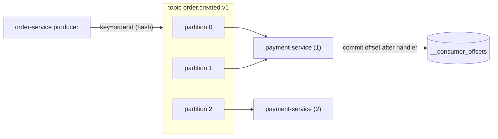

# 05. Kafka basics: topics, partitions, consumer groups, KRaft

**In plain words.** Kafka is an append-only log split into **topics** (`order.created.v1`).
Each topic is split into **partitions** (we use 3). A producer picks the partition by
hashing the message **key**, so all events with the same key (one `orderId`) land in the
same partition, in order. Consumers read with a **consumer group**: the group's members
share the partitions, and each message goes to one member. The group remembers how far it
got by committing an **offset**, the number of the _next_ message to read. **KRaft** means
Kafka manages its own metadata with a built-in Raft quorum; ZooKeeper is gone (removed in
Kafka 4.0).

**Why here (choices in `libs/kafka` and compose).**

- **Commit after the work, not before** (`autoCommit: false`). If the process dies
  mid-handler, the offset was not committed and the message comes back: at-least-once
  delivery. The price is duplicates, which idempotent consumers handle (#11).
- **Idempotent producer, `acks=all`.** A send only succeeds once all in-sync replicas have
  it, and internal retries cannot write the same message twice.
- **`fromBeginning: true` for new groups.** On a first deploy, payment-service would
  otherwise skip every order created before it started.
- **Auto topic creation off.** A typo in a topic name fails loudly instead of creating an
  empty topic nobody reads. We saw exactly this error (`UNKNOWN_TOPIC_OR_PARTITION`) while
  testing.
- **Shutdown order.** Consumers leave the group first (`onModuleDestroy`) and finish their
  in-flight message; the producer and the DB pool close last (`onApplicationShutdown`).

| Concept            | Kafka / ShopFlow                            | .NET / Azure analogue                             |
| ------------------ | ------------------------------------------- | ------------------------------------------------- |
| Topic + partitions | `order.created.v1`, 3 partitions            | Event Hubs hub + partitions                       |
| Message key        | `orderId` keeps per-order order             | Event Hubs partition key / Service Bus session ID |
| Consumer group     | `groupId: 'payment-service'`                | Event Hubs consumer group                         |
| Offset commit      | `commitOffsets` after handler               | `UpdateCheckpointAsync` in the processor          |
| Client library     | kafkajs behind `libs/kafka`                 | Confluent.Kafka (`IProducer`, `IConsumer`)        |
| Hosted lifecycle   | `onModuleDestroy` / `onApplicationShutdown` | `IHostedService.StopAsync`                        |

## Interview questions

1. **How does Kafka guarantee ordering?** Only within a partition. Use the aggregate ID as
   the key so all of an aggregate's events go to one partition. Adding partitions later
   changes the key-to-partition mapping, so plan the count up front.
2. **What happens in a consumer group rebalance?** When a member joins, leaves or stops
   heartbeating, partitions are reassigned. Uncommitted messages are redelivered to the new
   owner, which is why handlers must be idempotent and why consumers should leave cleanly
   on shutdown (a fast rebalance instead of waiting for a session timeout).
3. **At-most-once vs at-least-once vs exactly-once?** Commit before processing: at most once
   (crash = lost). Commit after: at least once (crash = duplicate). Kafka transactions give
   exactly-once only for Kafka-to-Kafka pipelines; with a database side effect you get
   "effectively once" through at-least-once delivery plus an idempotent consumer.
