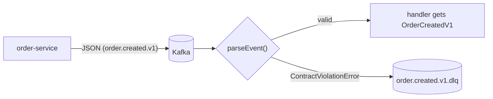

# 06. Event contracts and schema evolution

**In plain words.** An event is a public API with no compiler between producer and
consumer: order-service writes JSON today, payment-service reads it next week, maybe after
either side was redeployed. The **contract** (`libs/contracts`) is the one place that
says what each topic carries. Each message is checked at the edge (`parseEvent`) and turns
from `unknown` into a typed `OrderCreatedV1`, or fails as a `ContractViolationError`.

**Why here.**

- **zod: schema = type.** `z.infer` derives the TypeScript type from the runtime schema,
  so the two can never drift (a class-validator DTO would declare both separately).
- **Tolerant reader.** Unknown fields are stripped, not rejected. A producer can _add_ an
  optional field to v1 and old consumers keep working.
- **Breaking change = new topic.** Renaming/removing a field or changing its meaning goes
  to `order.created.v2`; the producer publishes both until every consumer has moved.
- **Shape, not business rules.** The contract says "integer ≥ 0", not "≤ 50 items". API
  limits live in order-service; putting them in the contract would force every consumer
  to redeploy when one limit changes.
- **Poison messages.** Bad JSON or a wrong shape can never succeed on retry, so #12 sends
  `ContractViolationError` straight to the DLQ. The error lists paths, never values
  (events carry customer data).

| Concept           | ShopFlow                               | .NET analogue                                         |
| ----------------- | -------------------------------------- | ----------------------------------------------------- |
| Shared contract   | `libs/contracts` (types + zod schemas) | `Contracts` NuGet package of message records          |
| Runtime check     | `parseEvent(topic, value)`             | `JsonSerializer.Deserialize` + FluentValidation       |
| Tolerant reader   | zod strips unknown keys                | System.Text.Json ignores unknown members by default   |
| Versioning        | `.v1` in topic and `type`              | MassTransit message type URN / versioned record names |
| Schema governance | none (monorepo, one team)              | Confluent Schema Registry + Avro/Protobuf             |

## Interview questions

1. **How do you evolve an event schema without breaking consumers?** Additive,
   optional changes only within a version (consumers ignore unknown fields; producers
   never remove or repurpose a field). For a breaking change publish a new version
   (`.v2` topic or `type`) in parallel, migrate consumers, then retire v1.
2. **Why no schema registry here?** One repo, one team, all services built from the same
   commit: the shared library is the registry and the compiler checks producers. A
   registry (Avro/Protobuf + compatibility checks at publish time) pays off with many
   teams, many languages or independent release trains.
3. **Shared contracts library: isn't that coupling?** Coupling to the _contract_ is the
   point; coupling to another service's _internals_ is not. The lib holds only message
   shapes and topic names, no logic or entities, and versions are immutable once
   published.
