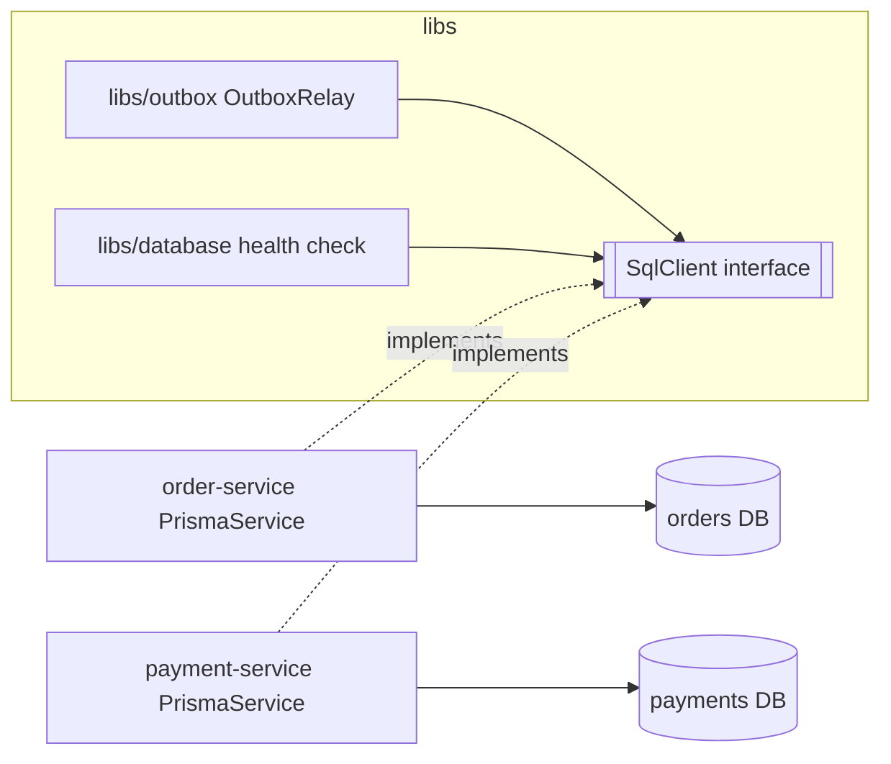

# 08. Shared libraries in a microservice monorepo

**In plain words.** Two services need the same outbox relay and the same database
readiness check. Copying them means two copies of subtle concurrency code that drift
apart. So we moved them into `libs/outbox` and `libs/database`, and each service plugs
its **own** database client in. A shared library is code compiled into each service, not
a shared runtime dependency: services still deploy, scale and fail independently.

**Why it is safe here (dependency inversion).**

- The libs define the small interface they need (`SqlClient`: `$queryRaw`,
  `$executeRaw`, `$transaction`), never a service's generated Prisma types.
- Each app wires its client: `DatabaseModule.forRoot({ client: PrismaService })`. The
  parameter type `Type<TransactionalSqlClient>` makes the compiler prove the fit.
- The relay only assumes a table _shape_ (`outbox` with fixed columns), which every
  service creates in its own database. No table is shared.

| Concept               | ShopFlow                                 | .NET analogue                                  |
| --------------------- | ---------------------------------------- | ---------------------------------------------- |
| Shared infrastructure | `libs/outbox`, `libs/database`           | internal NuGet package (`Company.Messaging`)   |
| Plug-in point         | `DATABASE` token + `SqlClient` interface | `IDbConnectionFactory` / `DbContext` interface |
| Registration          | `DatabaseModule.forRoot({ client })`     | `services.AddOutbox<OrdersDbContext>()`        |

**What must not be shared:** domain logic and entities (an `Order` class in a lib couples
every service to order-service's model), database tables, and generated clients.

## Interview questions

1. **What belongs in a shared library in microservices?** Cross-cutting infrastructure
   (messaging, outbox, health, logging, contracts). Not domain models or business rules:
   those make services change together, which is a distributed monolith.
2. **Isn't a shared lib coupling?** Build-time coupling only, and versioned with the
   monorepo; each service still owns its data and deploys alone. Keep libs small and
   stable; a breaking change to a lib is a change to every service that uses it.
3. **Why an interface instead of importing PrismaService?** Each service generates its
   own Prisma client for its own schema; the lib cannot know those types. Depending on a
   minimal interface (dependency inversion) lets one relay serve any service's database
   and makes it trivial to fake in unit tests.
