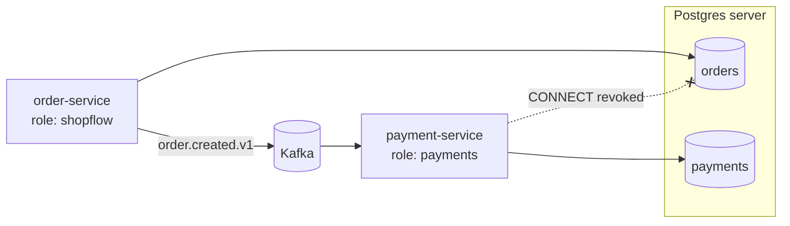

# 09. Database-per-service, enforced by credentials

**In plain words.** Each service owns its data: only order-service touches `orders`,
only payment-service touches `payments`. Other services learn about that data through
**events** (or an API), never by querying the tables. Locally both databases live in one
Postgres server, but each has its own **role**, and the default "any role may connect"
grant is revoked, so the boundary is enforced by Postgres, not by good intentions.

**Why here.**

- **Independent change.** payment-service can rename a column or move to another
  database engine without coordinating with order-service.
- **Independent failure and scale.** In production the databases can sit on separate
  servers; a slow report on `orders` cannot lock `payments`.
- **No sneaky joins.** Verified: the `payments` role gets
  `User does not have CONNECT privilege` on `orders`.
- **Data arrives by event.** order.created.v1 carries everything payment-service needs
  (amount, currency), so it never calls order-service in the saga.
- **Least privilege in tooling too.** The migration was generated with
  `prisma migrate diff` and applied by the `payments` role itself; `migrate dev` would
  need CREATEDB for its shadow database, which a service role should not have.
- **Idempotent init job.** `postgres-init` runs on every `compose up` (the image's init
  folder only runs on an empty volume) and uses `IF NOT EXISTS` logic.

| Concept            | ShopFlow                         | .NET / Azure analogue                        |
| ------------------ | -------------------------------- | -------------------------------------------- |
| Own DB per service | `orders`, `payments` databases   | one Azure SQL database per service           |
| Own credentials    | `payments` role, CONNECT revoked | contained DB user / managed identity per app |
| Schema migrations  | Prisma migrations per app        | EF Core migrations per `DbContext` project   |
| Cross-service data | events (`order.created.v1`)      | integration events via Service Bus           |

**What you give up:** cross-service joins (build read models from events instead),
cross-service transactions (use a saga, as we do), and one-query reporting (use a data
warehouse fed by events or CDC).

## Interview questions

1. **Why does each service own its database?** So services can change schema, scale and
   fail independently. A shared database couples deployments: one migration can break
   another team's service (the "integration database" anti-pattern).
2. **How does payment-service get order data without calling order-service?** The event
   carries it: order.created.v1 includes amount, currency and items. That keeps the saga
   asynchronous and payment-service working even if order-service is down.
3. **Separate databases on one server: is that really isolated?** Data and credentials
   are isolated (enforced by roles and CONNECT grants); resources are not, since they share
   CPU, memory and I/O. Fine for local and small deployments; move a database to its own
   server when load or blast radius demands it, without code changes.
