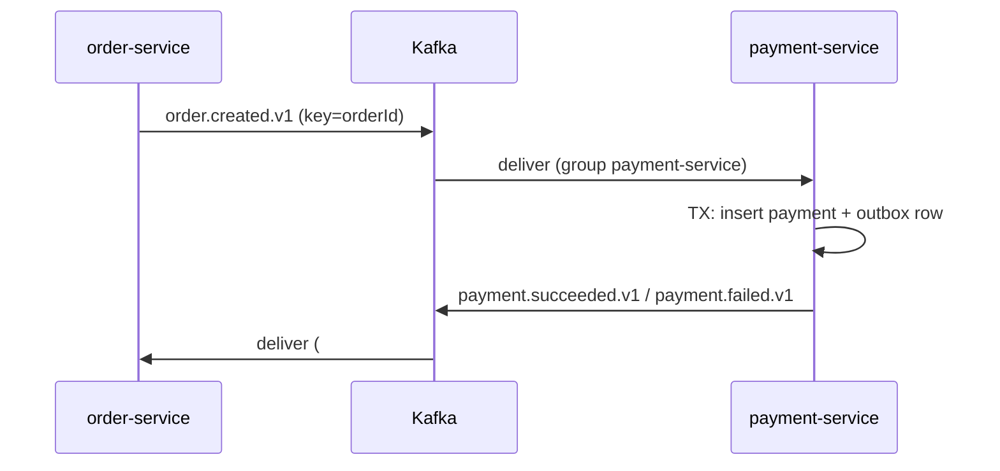

# 10. Choreography saga: services reacting to each other's events

**In plain words.** Placing an order spans two services and two databases, so there is
no single transaction. A **saga** splits it into local transactions, each publishing an
event that triggers the next step. In **choreography** nobody is in charge: every service
listens for the events it cares about and reacts. ShopFlow's steps:

1. order-service: save order (PENDING) + `order.created.v1` (outbox).
2. payment-service: consume it, simulate the charge, save payment +
   `payment.succeeded.v1` or `payment.failed.v1` (outbox). **(this issue)**
3. order-service: mark the order PAID or PAYMENT_FAILED (#13). A failed payment is the
   saga's "compensation": the order is rejected instead of rolled back.

**How payment-service stays safe.**

- **Thin handler.** `OrderCreatedConsumer` only parses (`parseEvent`) and delegates to
  `PaymentsService`; logic is testable without Kafka.
- **Atomic step.** Payment row + result event commit in one transaction (outbox).
- **Redelivery is harmless.** `payments.order_id` is unique: a replayed event hits the
  constraint and is skipped (verified live: 1 payment, 1 event after a replay). #11 adds
  a general processed-event table.
- **Poison messages don't block.** Invalid JSON is logged and skipped so the partition
  keeps moving (verified: lag 0); #12 sends them to a DLQ instead.
- **Traceable.** The result event copies the order's `correlationId`.
- **Dummy charge.** Deterministic: above `PAYMENT_DECLINE_ABOVE_CENTS` (default
  1000.00) it is declined; no provider, no card data.

| Concept               | ShopFlow                                    | .NET analogue                                 |
| --------------------- | ------------------------------------------- | --------------------------------------------- |
| Choreography step     | `OrderCreatedConsumer` -> `PaymentsService` | MassTransit `IConsumer<OrderCreated>`         |
| Orchestration instead | (not used) a central saga coordinator       | MassTransit state machine / Durable Functions |
| Natural idempotency   | unique `order_id` (P2002 -> skip)           | unique index + `DbUpdateException` handling   |
| Background start      | consumer starts after bootstrap, retries    | `BackgroundService.ExecuteAsync` with retry   |

## Interview questions

1. **Choreography vs orchestration: when would you pick each?** Choreography for few
   steps and loosely coupled teams: no central point of failure, but the flow is implicit
   (spread over services) and hard to see. Orchestration (a coordinator that sends
   commands and tracks state) once there are many steps, branches or timeouts: explicit
   flow, easier monitoring, but the orchestrator becomes a dependency.
2. **How do you "roll back" in a saga?** You can't; each step already committed. You run
   compensating actions (refund, release stock, mark order failed) triggered by failure
   events. Design every step so it has a compensation or cannot fail after it.
3. **What if the same order.created event arrives twice?** At-least-once delivery makes
   that normal. The step must be idempotent: here the unique `order_id` makes the second
   insert fail, and we treat that as "already done" (commit the offset, publish nothing).
