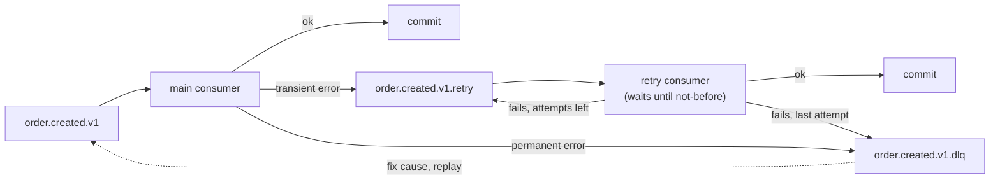

# 12. Retries, backoff with jitter and dead-letter topics

**In plain words.** Some failures fix themselves (database restarting, network blip):
those deserve another try, later. Others never will (a message that is not valid JSON):
retrying them only wastes time. And a failing message must not hold up everything behind
it in its partition (**head-of-line blocking**). So ShopFlow:

1. tries the handler once;
2. on a **transient** error, moves the message to `<topic>.retry` with a "not before"
   time and commits, so the main partition keeps flowing;
3. a separate retry consumer waits until that time and tries again (up to
   `CONSUMER_MAX_ATTEMPTS`);
4. on a **permanent** error, or when attempts run out, parks it in `<topic>.dlq` with
   headers saying where it came from and why it failed.

A declined payment is **not** an error: it is a business outcome published as
`payment.failed.v1`, never retried.

**Backoff with full jitter.** Delay = random(0, base × 2^(attempt-1)), capped at 30 s.
Exponential so a struggling dependency gets breathing room; random so a thousand
consumers that failed at the same moment don't all retry at the same moment
(thundering herd).

**Verified live** (payments table hidden to fake a DB outage):

- Recovered: attempts 1-3 failed, the table came back, attempt 4 succeeded.
- Exhausted: 4 failures → `order.created.v1.dlq` with `x-original-offset`,
  `x-error-type`, `x-retry-attempt: 4`, original key.
- Poison `{not json` → DLQ at attempt 1 (`ContractViolationError`); the next valid order
  was paid; lag 0 on both groups.
- Replay: copied the parked message back to `order.created.v1` → paid; replayed again →
  "Duplicate event … skipped", still one payment.

| Concept            | ShopFlow                               | .NET analogue                               |
| ------------------ | -------------------------------------- | ------------------------------------------- |
| Retry with backoff | `.retry` topic + `x-retry-not-before`  | MassTransit `UseDelayedRedelivery` / Polly  |
| Dead-letter        | `<topic>.dlq` with `x-error-*` headers | Service Bus dead-letter sub-queue           |
| Permanent errors   | `isPermanent(error)`                   | Polly `Handle<T>()` filters / `Ignore<T>()` |
| Jitter             | full jitter in `backoffDelay`          | Polly `Backoff.DecorrelatedJitterBackoffV2` |

## Interview questions

1. **How do you stop one bad message from blocking a partition?** Classify errors.
   Permanent ones (bad payload) go straight to a DLQ. Transient ones move to a retry topic
   and the original offset is committed, so the partition keeps flowing. The cost: ordering
   per key is no longer guaranteed for retried messages.
2. **How do you replay a DLQ?** Fix the root cause first, then re-publish the parked
   messages (same key and value) to the source topic, via a small tool or Kafka UI.
   Consumers must be idempotent so replaying twice is harmless. Keep the `x-original-*`
   headers for auditing.
3. **Why jitter?** Without it, clients that failed together retry together and can knock
   over the recovering dependency again (thundering herd). Randomising the delay spreads
   the load.
