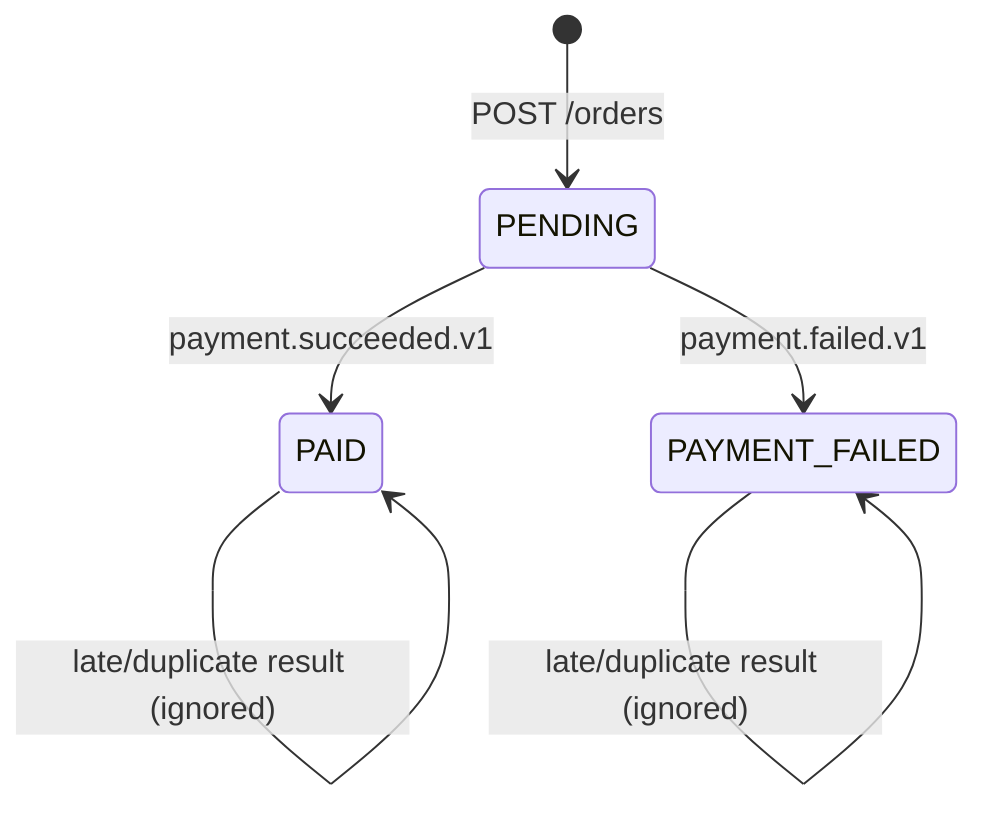

# 13. Completing the saga: state machine, compensation, eventual consistency

**In plain words.** `POST /orders` answers immediately with `status: PENDING`. A few
seconds later payment-service has decided and order-service has applied the result:
the order becomes `PAID` or `PAYMENT_FAILED`. Between those moments the system is
**eventually consistent**: each database is correct on its own, and they agree once the
events have flowed (about 3 s locally).

**The state machine.** `PENDING -> PAID | PAYMENT_FAILED`; final states never change.
It is enforced in one SQL statement:

```sql
UPDATE orders SET status = $outcome WHERE id = $id AND status = 'PENDING'
```

The `WHERE status = 'PENDING'` turns "check, then write" into one atomic
**compare-and-set**: if two results race, exactly one updates a row; the other sees
`count = 0` and is ignored. No locks held in application code.

**Why this matters now.** Retry topics (#12) can deliver a payment result after newer
ones, and Kafka redelivers. Forward-only transitions plus `processed_events` (#11) make
every arrival order safe:

| Arrival                              | Result                                        |
| ------------------------------------ | --------------------------------------------- |
| first result for a PENDING order     | applied (PAID / PAYMENT_FAILED)               |
| same event again                     | `duplicate`, nothing written                  |
| a different result for a final order | `ignored` and logged, status unchanged        |
| result for an unknown order          | `OrderNotFoundError` → DLQ; claim rolled back |

**Compensation.** A saga cannot roll back committed steps. `PAYMENT_FAILED` is the
compensating outcome: the order is rejected instead of "undone". (With stock reservation
the compensation would also release the stock.)

**How the client learns the final status.** Today: poll `GET /orders/:id` until it is not
`PENDING` (simple, cacheable). Alternatives: webhooks, Server-Sent Events / WebSockets
pushed by a notification service, or `202 Accepted` + a status URL.



| Concept                | ShopFlow                              | .NET analogue                                   |
| ---------------------- | ------------------------------------- | ----------------------------------------------- |
| Compare-and-set        | `updateMany where status = 'PENDING'` | EF Core `ExecuteUpdate` with a status predicate |
| Optimistic alternative | (not used) version column             | `[ConcurrencyCheck]` / `rowversion`             |
| Saga state             | order status column                   | MassTransit saga state machine instance         |

## Interview questions

1. **How does the client learn the final status?** The create call returns PENDING
   (async). The client polls `GET /orders/:id`, or the system pushes it (webhook, SSE,
   WebSocket via a notification service). Return `202 Accepted` with a status link if you
   want to make the async nature explicit.
2. **What if payment events arrive out of order (or twice)?** Transitions only go forward
   from PENDING, enforced atomically in the UPDATE's WHERE clause; duplicates are caught
   by the processed-event table. Whatever arrives first wins; later results are logged
   and acknowledged.
3. **What is compensation in a saga?** A business action that semantically undoes an
   earlier committed step (refund, release stock, cancel order), triggered by a failure
   event, because distributed transactions (2PC) are not available or not wanted.
