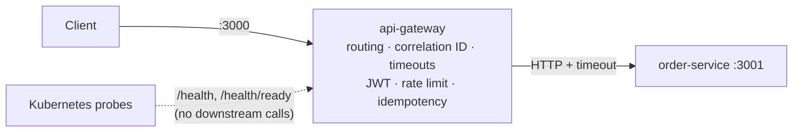

# 14. The API gateway: what lives at the edge, and what its health means

**In plain words.** Clients will talk to exactly one service, `api-gateway` (:3000). It
owns the concerns that apply to every request: routing, correlation IDs and timeouts
(#15), then JWT (#16), rate limiting (#17) and idempotency keys (#19). Business rules
(order totals, status transitions) stay in the services. A gateway that starts deciding
business rules turns into a distributed monolith that every team has to change.

**Readiness that ignores downstreams.** `GET /health/ready` deliberately does not call
order-service. If it did, a 10-second order-service blip would mark every gateway pod
unready. Kubernetes would pull them all out of the Service, and routes that were healthy
(later `/payments`, `/health`) would go down with it: a **cascading failure**. A
gateway's readiness answers "can _this process_ take traffic?". A down downstream shows up
per request as 502/504 (#15), and later a circuit breaker can make it fail fast.

**One error body everywhere.** The RFC 9457 problem-details filter moved from
order-service into `libs/errors` (`@shopflow/errors`), together with `DomainError`.
Clients now parse one error format whichever service answered, and the gateway can pass
downstream problem bodies straight through. The lib's tests use their own fixture errors:
a library must never import an app.

**Fail fast on config.** `ORDER_SERVICE_URL` is required and must be http(s). A missing
or bad value stops the process at boot, and the message names the variable without
echoing its value. `DOWNSTREAM_TIMEOUT_MS` (100 ms to 30 s, default 3 s) is validated now
and used by the proxy in #15.

**.NET equivalent.** YARP (`Yarp.ReverseProxy`) or Ocelot in an ASP.NET Core host, with
`AddHealthChecks()`. Liveness and readiness are split by tags (`MapHealthChecks("/health/ready",
new() { Predicate = c => c.Tags.Contains("ready") })`). Moving the problem filter into a lib
is like sharing `ProblemDetailsFactory` / `IExceptionHandler` through a common NuGet package.

## Interview questions

1. **What belongs in an API gateway, and what doesn't?**
   Cross-cutting edge concerns: TLS termination, authentication (JWT validation), rate
   limiting, routing, correlation IDs, timeouts, caching and request shaping (BFF).
   Business logic and data ownership don't. Those stay in services, or the gateway becomes
   a coupling point every team has to deploy.
2. **Should the gateway's readiness probe check its downstream services?**
   No. Readiness is about the pod itself. Checking downstreams couples availability: one
   slow service drains every gateway pod and takes healthy routes down too. Handle downstream
   failure per request (timeout -> 504, refused -> 502, circuit breaker).
3. **Why build the gateway in NestJS instead of using Kong or Envoy?**
   Here, to learn and explain every concern (ADR 0003). In production, many teams put
   Kong/Envoy/a cloud API gateway in front for TLS, routing and rate limits, and keep a thin
   BFF in code for product-specific aggregation.
