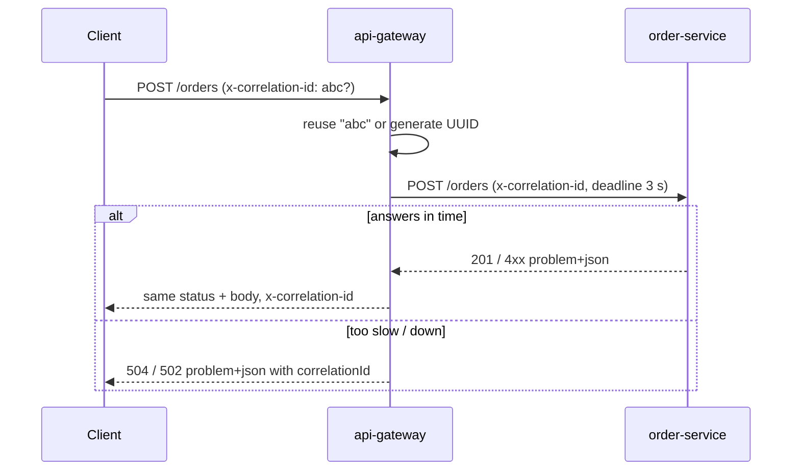

# 15. Correlation IDs and timeouts at the gateway

**In plain words.** Every request through `api-gateway` gets one ID in `x-correlation-id`.
The gateway reuses the caller's ID if it is short and plain, and otherwise generates a
UUID. It sends the ID to order-service, returns it in the response header, and puts it in
every error body. When a user reports "my order failed", they quote that ID and you can
search every service's logs for it. Next, #51 carries it into `order.created`, so the same
ID follows the request through Kafka to payment and back.

**Why validate an incoming ID?** It is client input that ends up in logs, response bodies
and events. `^[A-Za-z0-9._-]{1,128}$` blocks log injection (`\r\n` fake log lines), markup
and huge values. One rule lives in `@shopflow/errors`, shared by the middleware and the
error filter.

**Timeouts on every outbound call.** Without a deadline, a hung order-service holds the
gateway's sockets and memory until the gateway itself stops answering. That is how one
slow service takes the whole edge down. `fetch(url, { signal: AbortSignal.timeout(3000) })`
bounds connecting and reading the body. Keep the timeout shorter than the client's, so the
gateway answers first with a meaningful error:

| What happened downstream          | Gateway answers                         |
| --------------------------------- | --------------------------------------- |
| any HTTP status (201, 400, 404 …) | the same status and body, unchanged     |
| no answer within the deadline     | **504** Gateway Timeout (problem+json)  |
| connection refused / reset / DNS  | **502** Bad Gateway (problem+json)      |
| invalid `:id` (not a UUID)        | **400** at the edge, downstream not hit |

Timeout detection asks `deadline.aborted` instead of checking the error type. The
rejection's shape differs between runtimes, and the e2e test against a real stalled
server caught exactly that: the mocked test passed while the real run returned 502.

**Explicit routes, allowlisted headers.** The gateway exposes `POST /orders`,
`GET /orders` and `GET /orders/:id`, and nothing else from order-service. It forwards only
`accept`, `content-type` and `x-correlation-id`, so cookies, `Host` and hop-by-hop headers
stay at the edge. The downstream path is built from a validated UUID, so `/orders/..`
can't reach other order-service paths.

**.NET equivalent.** In YARP, a request transform adds the header and
`HttpClient.Timeout` (or `ForwarderRequestConfig.ActivityTimeout`) sets the deadline.
Middleware sets `HttpContext.TraceIdentifier`, and the Polly / `Microsoft.Extensions.Http.Resilience`
pipeline adds timeout and circuit-breaker policies. `CancellationTokenSource.CancelAfter`
plays the role of `AbortSignal.timeout`.

## Interview questions

1. **Why should every outbound call have a timeout?**
   A call without one can wait forever. Slow downstreams pile up waiting requests, which
   exhaust sockets, memory and threads, and the caller fails too (cascading failure). A
   deadline turns "slow" into a fast, explicit error the caller can handle, retry or
   circuit-break on.
2. **502 vs 504: what's the difference, and why does it matter?**
   502 means the gateway got no valid answer: refused connection, reset or DNS failure,
   usually because the service is down. 504 means the upstream did not answer in time,
   usually because it is overloaded or stuck. Separate codes point on-call engineers at
   the right cause, and alerts can treat them differently.
3. **Correlation ID vs trace ID (OpenTelemetry)?**
   A correlation ID is one opaque value you pass along by hand to group logs. A W3C
   `traceparent` / OTel trace adds span IDs, parent/child timing and sampling, and is
   propagated automatically by instrumentation. Many systems keep both: the trace for
   latency analysis, the correlation ID as a stable, user-quotable support reference.
