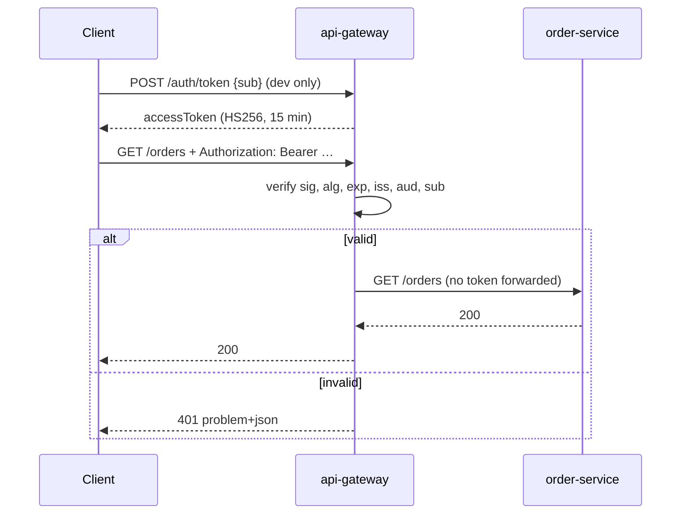

# 16. JWT authentication at the gateway

**In plain words.** A JWT is a signed JSON statement: "subject `c-77`, issued by
`shopflow-gateway`, for `shopflow-api`, valid until 10:15". The gateway checks the
signature and the claims on every request and needs no session store or database lookup.
That is **stateless authentication**, and it is why any gateway pod can serve any request.
The services behind it never see the token: auth ends at the edge.

**What the guard verifies (all must pass, otherwise 401):**

| Check                 | Stops                                                    |
| --------------------- | -------------------------------------------------------- |
| signature (HS256 key) | forged or edited tokens (change one byte → invalid)      |
| `algorithms: [HS256]` | `alg: none` tokens and algorithm-confusion attacks       |
| `exp`                 | stolen tokens being used forever                         |
| `iss` / `aud`         | tokens minted by another issuer, or for another API      |
| `sub` present         | correctly signed tokens that don't say who the caller is |

The 401 is problem+json with `WWW-Authenticate: Bearer` (RFC 6750). The body never says
_why_ the token failed; that would be a hint for attackers, not clients.

**Secure by default.** The guard is global (`APP_GUARD`), and routes opt out with
`@Public()` (health, dev token). A new route someone forgets to annotate is protected,
not exposed.

**The dev token endpoint** (`POST /auth/token {"sub":"c-77"}`) stands in for a real
identity provider (Keycloak, Entra ID, Auth0) and answers 404 unless
`NODE_ENV=development`. **Known gap (#53):** `customerId` still comes from the order body,
so an authenticated user can order "as" someone else until the gateway uses `sub`.

**.NET equivalent.** `AddAuthentication().AddJwtBearer(o => o.TokenValidationParameters = new() { ValidIssuer, ValidAudience, IssuerSigningKey, ValidAlgorithms = ["HS256"] })`,
a fallback policy `RequireAuthenticatedUser()` (the global guard) and `[AllowAnonymous]`
(our `@Public()`). `dotnet user-jwts` plays the role of the dev token endpoint.

## Interview questions

1. **JWT vs session cookie?**
   A session is an ID pointing to server-side state: easy to revoke, but every instance
   needs a shared session store. A JWT carries its claims and is verified with a key: it
   scales horizontally and works across services, but it is hard to revoke and bigger on
   the wire. Browsers: a cookie (HttpOnly, SameSite) often still carries the token.
2. **How do you revoke a JWT?**
   You mostly don't. Keep access tokens short (here 15 min) and use refresh tokens that
   _are_ revocable server-side. For emergencies, keep a deny-list of `jti` values (in Redis)
   until they expire, or rotate the signing key, which logs everyone out.
3. **HS256 vs RS256?**
   HS256 uses one shared secret to sign and verify, so every verifier could also mint
   tokens. That is fine for one service (our gateway). RS256/ES256 sign with a private key
   and verify with a public key published via JWKS, so many services can verify without
   being able to issue tokens. That is what OIDC providers use. Always pin the accepted
   algorithms.
