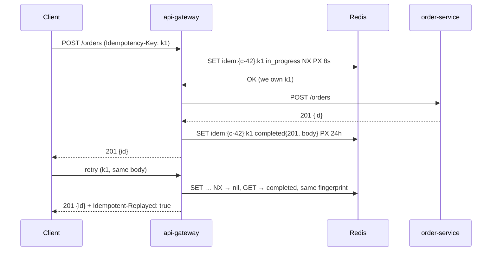

# 18. Idempotency keys: safe retries for POST

**In plain words.** A client sends `POST /orders`, and the network drops before the
answer arrives. Did the order get created? The client can't know, so it retries. Without
protection, that retry is a second order and a second charge. With an
`Idempotency-Key: <uuid>` header (one per logical order attempt), the gateway remembers
the first answer and returns it for every retry: **at most one order per key**.
`GET`/`PUT`/`DELETE` are idempotent by definition; `POST` needs this help.

**How it works (Stripe-style), in Redis:**

| Situation                             | Answer                                         |
| ------------------------------------- | ---------------------------------------------- |
| first request with the key            | forwarded; final response stored for 24 h      |
| same key, same body, finished         | stored response + `Idempotent-Replayed: true`  |
| same key while the first is in flight | **409** `IDEMPOTENCY_KEY_IN_USE` (retry later) |
| same key, different body              | **422** `IDEMPOTENCY_KEY_REUSED` (client bug)  |
| no key                                | **400**                                        |
| Redis down                            | **503** + `Retry-After` (fail closed)          |

- **The lock** is `SET key "in_progress" NX PX <timeout + 5 s>`. `NX` means exactly one
  request wins, even across gateway replicas (verified live: two parallel requests gave
  201 + 409). The PX expiry means a crashed gateway can't lock a key forever.
- **The fingerprint** is a SHA-256 of method + path + the body as canonical JSON (keys
  sorted). It catches key reuse with different content, a client bug that must not
  silently return an unrelated order.
- **Scope:** keys live under the JWT `sub` (`idempotency:{c-42}:<key>`), so another user
  can never replay your response by guessing your key.
- **What's stored:** 2xx and 4xx are final answers and get stored. 5xx and timeouts free
  the key so the client may retry.

**Why fail closed here, when rate limiting fails open?** A missing rate limit costs some
capacity for a while. A missing idempotency check can cost a customer a double charge.
Same Redis, different risk, different decision.

**The known gap (#56).** If order-service commits the order but answers after the
gateway's 3 s deadline, the gateway returns 504 and frees the key, and the retry creates
a second order. A cache in front of a service cannot make that service exactly-once.
The real fix is to forward the key and enforce it with a unique column in order-service,
in the same transaction as the order and its outbox row.

**.NET equivalent.** There is no built-in middleware. Teams write an action filter or
middleware with `IDistributedCache`/StackExchange.Redis (`When.NotExists` = `NX`), or use
a library. The end-to-end version is a unique index on an `IdempotencyKey` column in EF
Core, catching `DbUpdateException` on a duplicate.

## Interview questions

1. **How does Stripe-style idempotency work?**
   The client generates a unique key per operation and resends it on every retry. The
   server atomically claims the key, runs the operation once, and stores the result
   against it. Retries get the stored result. A different request under the same key is
   rejected, and a still-running request gets 409.
2. **What TTL, and why?**
   The TTL must be longer than any client's retry window (network retries, queued mobile
   requests, a user pressing "retry" later); Stripe keeps keys 24 h. After that, the same
   key counts as a new request. Longer only costs storage. The in-progress lock is short
   (request timeout plus a margin), so crashes don't block a key for a day.
3. **Is the idempotency check at the gateway enough?**
   No. It deduplicates retries the gateway can answer, but when the gateway times out it
   doesn't know whether the downstream committed. Exactly-once needs the owner of the data
   to enforce the key, e.g. a unique constraint written in the same transaction as the
   order. Consumers of the resulting events still deduplicate by `eventId` (#11).
