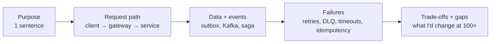

# 19. Explaining a system in an interview

**In plain words.** Interviewers rarely want every detail. They want to see that you can
choose the right level, name the trade-offs, and know where it breaks. A good system
explanation has a shape: **purpose → request path → data and events → failure handling →
what I'd change.** `docs/INTERVIEW.md` is ShopFlow's version; the README demo is the
proof.

**The rules we used**

- **Start with one sentence of purpose**, then follow one request end to end. The path
  gives the listener a skeleton to hang every pattern on.
- **Name each pattern with its reason and its cost.** "Outbox, because the dual write can
  lose events; costs a table, a relay and at-least-once delivery." A pattern without a cost
  sounds memorised.
- **Lead with failure.** "What happens when Kafka is down?" is the question behind most
  questions. Answering with a demo you ran (orders stay `PENDING`, then `PAID` ~36 s after
  Kafka returns) beats any diagram.
- **Volunteer the gaps.** Saying "idempotency is gateway-only, so a retry after a 504 can
  duplicate; the fix is a unique key in order-service" shows judgement. Being caught out
  shows the opposite.
- **Scale answers in layers, measurement first:** stateless tiers out → partitions →
  database (pooling, replicas, cache, partitioning) → edge → observability.

**.NET equivalent.** The same structure works for any .NET system you have built: "ASP.NET
Core API behind YARP → EF Core + outbox (MassTransit) → RabbitMQ/Azure Service Bus →
consumers with inbox tables → Polly for timeouts and retries." Mapping your 8 years of
.NET work onto these pattern names is the fastest way to sound senior in a Node interview.

## Interview questions

1. **"Walk me through your system."**
   Purpose in one sentence, then one order's path: gateway (JWT, rate limit, idempotency
   key, timeout) → order-service (order + outbox row in one transaction) → Kafka → payment
   (idempotent consumer, own outbox) → order-service (forward-only status update). Close
   with how failures are handled.
2. **"What would you change for 100× traffic?"**
   Measure first, then scale stateless pods horizontally, add Kafka partitions and
   consumers, then the database: pooling, read replicas, caching, archiving outbox and
   processed rows, CDC instead of polling. Redis in cluster mode, a managed edge for TLS
   and coarse limits, and tracing to find the next bottleneck.
3. **"What is the weakest part of your design?"**
   Pick a real one and its fix. Gateway-only idempotency (fixed with a unique key in
   order-service), or choreography getting hard to follow as steps grow (would move to an
   orchestrator such as Temporal).
