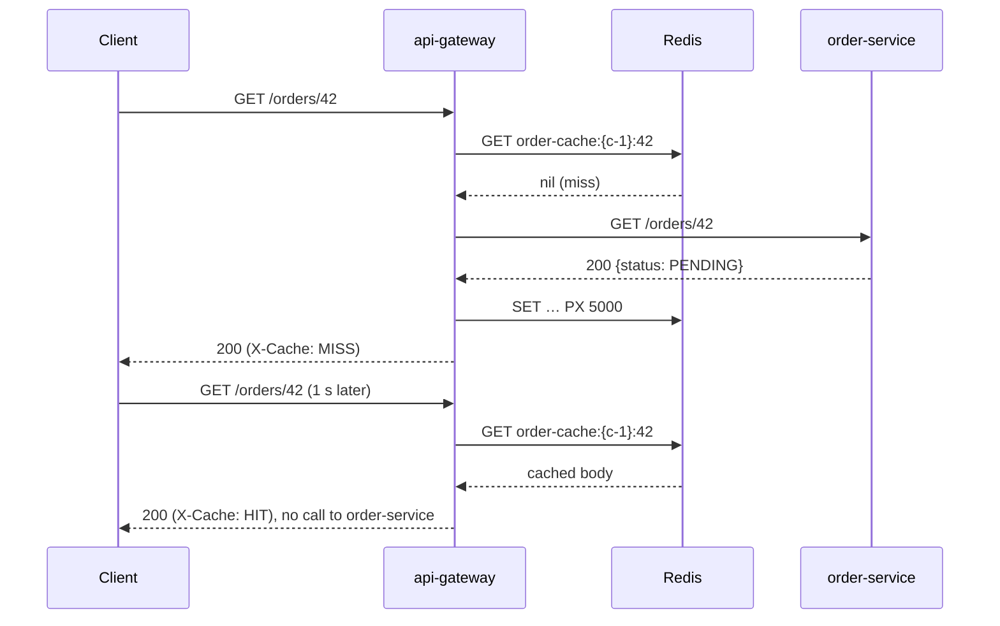

# 20. Response cache: cache-aside for order reads

**In plain words.** Clients poll `GET /orders/:id` to watch an order go from PENDING to
PAID. Every poll costs an HTTP hop and a Postgres query. The gateway now keeps the
answer in Redis for a few seconds (`ORDER_CACHE_TTL_SECONDS`, default 5), so repeated
reads within that window never reach order-service. The `X-Cache: HIT|MISS` header shows
which happened.

**Cache-aside** (also called lazy loading): the application, not the cache, does the
work. It reads the cache; on a miss it loads from the source and writes the cache. The
alternatives are read-through (the cache library loads for you), write-through (writes
update the cache) and write-behind (writes go to the cache first). Cache-aside is the
default because the cache stays optional, as shown by the fail-open row below.

| Rule in our code                  | Why                                                              |
| --------------------------------- | ---------------------------------------------------------------- |
| key `order-cache:{sub}:{orderId}` | one user's cached answer is never served to another              |
| only `200` is cached              | a cached 404 would hide an order created a moment later          |
| TTL only, no invalidation         | status changes happen in the saga, which the gateway doesn't see |
| Redis down → go to order-service  | **fail open**: a miss costs latency, not correctness             |

**The trade-off is staleness.** The saga flips PENDING → PAID in about 3 s. A client that
read the order just before that can see PENDING for up to 5 s more. That's fine for a
status page, but not for anything that makes a decision (refunds, shipping), which must
read order-service directly.

**Why not invalidate?** Doing it properly means the gateway consumes `payment.*` events
(or order-service publishes `order.status-changed`) and deletes the key. That's more
coupling and moving parts for a 5 s window. Since the key contains the user, deleting it
would also need a `SCAN` or a secondary index. A short TTL is the honest choice at this size.

**Cache stampede.** When a hot key expires, every concurrent request misses together and
all of them hit the database. Fixes: single-flight (one loader per key, others wait), a
short Redis lock around the load, probabilistic early refresh, and TTL jitter so keys
don't expire in sync. Our keys are per user and per order, so a stampede is at most one
user's parallel polls; we don't defend against it yet.

**.NET equivalent.** `IDistributedCache` (`GetStringAsync` / `SetStringAsync` with
`AbsoluteExpirationRelativeToNow`) over StackExchange.Redis, wrapped in a
`GetOrCreateAsync` helper. .NET 9's `HybridCache` adds an in-memory L1 tier and built-in
stampede protection. ASP.NET Core output caching (`[OutputCache]`) is the
middleware-level version.

## Interview questions

1. **How would you invalidate when the order status changes?**
   Event-driven: whoever sees the change (a consumer of `payment.succeeded`, or
   order-service after its UPDATE) deletes or overwrites the key. Delete after the DB
   commit, never before, or a concurrent reader can put the old value back. Keep a TTL
   anyway as a safety net for lost invalidations.
2. **What is a cache stampede, and how do you prevent it?**
   Many requests miss the same expired key at once and overload the source. Use
   single-flight or a lock so only one request loads, early or probabilistic refresh
   before expiry, and jittered TTLs.
3. **Why does the cache fail open while idempotency fails closed, on the same Redis?**
   The cost of failure differs. Without the cache, reads are slower but correct. Without
   idempotency, a retry can create a second order and a second charge. Pick the failure
   mode per feature based on what breaks, not per dependency.
