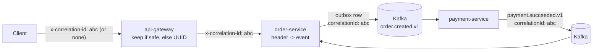

# 21. One correlation ID from HTTP through Kafka

**In plain words.** A correlation ID is a label stuck on one customer request, so every
log line and event caused by it can be found with a single search. Until now the label
broke at the outbox: the gateway used one ID for the HTTP call, and order-service
generated a different random one for `order.created`. Now order-service reads the
`x-correlation-id` header and writes it into the event, and payment-service already copies
it from the event onto its result. One ID now covers the whole saga.

**Design points**

- **Validate at every boundary, with one rule.** The header is client input that ends up
  in logs, error bodies and Kafka. `correlationIdOrNew` in `libs/errors` is the only
  rule: a short, plain ID is kept, anything else is replaced by a UUID. The gateway and
  order-service both call it, so they can't drift apart.
- **Each hop keeps the ID, never trusts it blindly.** order-service doesn't assume the
  gateway ran (someone may call it directly inside the cluster), so it validates again.
- **The event carries it in the envelope, not in Kafka headers.** It sits next to
  `eventId` and `occurredAt`, so it survives the outbox (a database row), retries and
  DLQ replays. Kafka headers would be lost the moment an event is stored and re-published.
- **Correlation ID ≠ event ID ≠ trace ID.** `eventId` is unique per message and is used
  for deduplication. `correlationId` is shared by every message of one business flow.
  W3C `traceparent` (OpenTelemetry, #28) adds spans and timing on top. The usual
  approach is to log both and later derive one from the other.

**The service doesn't know HTTP exists.** The controller extracts the header;
`OrdersService.create(command, correlationId)` just takes a string. A future Kafka- or
CLI-triggered order creation passes its own ID the same way.

**.NET equivalent.** `HttpContext.TraceIdentifier` / `Activity.Current` for the request
side, a delegating handler on `HttpClient` to forward the header, and MassTransit's
`ConsumeContext.CorrelationId` (copied onto published messages automatically) for the
messaging side. In NestJS we pass it explicitly because there is no ambient context yet.
`AsyncLocalStorage` (via `nestjs-cls`) would be the equivalent of `AsyncLocal<T>`.

## Interview questions

1. **How do you trace one request across asynchronous services?**
   Give it an ID at the edge, forward it in every HTTP header, and store it in every
   event envelope. Each consumer copies it onto the events it publishes and logs it on
   every line. Then one search on that ID in the log store shows the whole flow.
   OpenTelemetry adds parent/child spans for timing.
2. **Why not put the correlation ID only in a Kafka header?**
   With an outbox, the event first lives in a database row, and DLQ replays re-publish
   the stored value. Anything outside the stored envelope gets lost. Headers are fine for
   transport metadata such as `traceparent`, but the business correlation belongs in the
   payload contract.
3. **The client sends the header. Isn't that a security risk?**
   Only if it's used unvalidated: log injection, huge values, markup in error bodies. We
   accept at most 128 plain characters and otherwise generate our own. It's never used for
   authorization or deduplication, only for searching logs.
