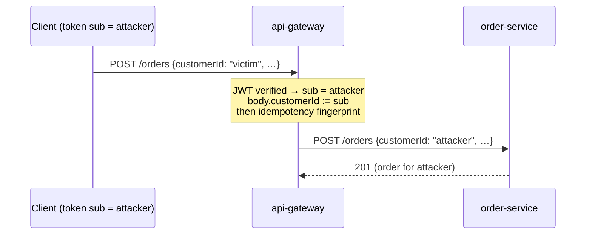

# 22. Identity comes from the token, not the body (BOLA)

**In plain words.** Until now a logged-in user could send
`{"customerId": "someone-else", …}` and the order was created for that other customer.
Authentication worked (we knew _who_ was calling), but nothing linked that to _what_ they
asked for. This is **BOLA** (Broken Object Level Authorization, also called IDOR), number 1
in the OWASP API Security Top 10. The fix is that the gateway overwrites `customerId` with
the JWT `sub` before forwarding. Whatever the client sends is ignored.

**Design points**

- **Overwrite, don't reject (Syed's choice).** The client may omit `customerId`
  entirely. A 403 on mismatch would also be correct and more explicit to clients, but
  then clients keep sending a field the server never trusts.
- **Bind before fingerprinting.** The idempotency fingerprint is computed from the
  rewritten body, so a retry with a different spoofed `customerId` replays the first
  order instead of failing with 422. The order in the code matters, and an e2e test pins it.
- **Only rewrite JSON objects.** An array or a string passes through unchanged, and
  order-service's validation rejects it. Body rules keep one owner.
- **The trust boundary.** order-service still believes the `customerId` in the body. That's
  safe only if nobody can reach it except the gateway: a Kubernetes NetworkPolicy (M5), and
  ideally mTLS. The stronger alternative is a trusted identity header (`x-user-id`) that
  order-service reads, with `customerId` removed from its API. Gateways such as
  Envoy/Istio do this with signed or re-issued tokens.
- **Reads are still open (#61).** `GET /orders/:id` returns any order to any
  authenticated user. The fix filters by owner and answers **404**, not 403, so it
  doesn't reveal that the order exists.

**.NET equivalent.** Read the user from `User.FindFirst(ClaimTypes.NameIdentifier)` (or
`sub`) in the controller and set it on the command; never bind it from `[FromBody]`.
Resource-based authorization (`IAuthorizationService.AuthorizeAsync(User, order,
"OwnerPolicy")`) covers the read side. In YARP, a request transform can set the
header or body from the claims.

## Interview questions

1. **What is BOLA/IDOR, and how do you prevent it?**
   The API checks _that_ you are logged in but not _whether this object is yours_, so
   changing an ID in the request reaches someone else's data. Prevent it by taking the
   owner from the authenticated principal, and on every object access filter or check by
   owner, server-side. Prefer 404 over 403 for objects the caller doesn't own.
2. **The gateway rewrites the body. Is order-service secure now?**
   Only as long as the gateway is the sole way in. Enforce that with network policy
   and/or mTLS between services, or have order-service verify identity itself: a forwarded
   JWT, or a gateway-signed internal token. Defence in depth means not relying on one
   layer.
3. **Why does it matter that the binding happens before the idempotency fingerprint?**
   Otherwise the fingerprint depends on a field the server ignores. A retry that differs
   only in that field would get a 422 instead of the replayed order, which breaks safe
   retries for no security gain.
