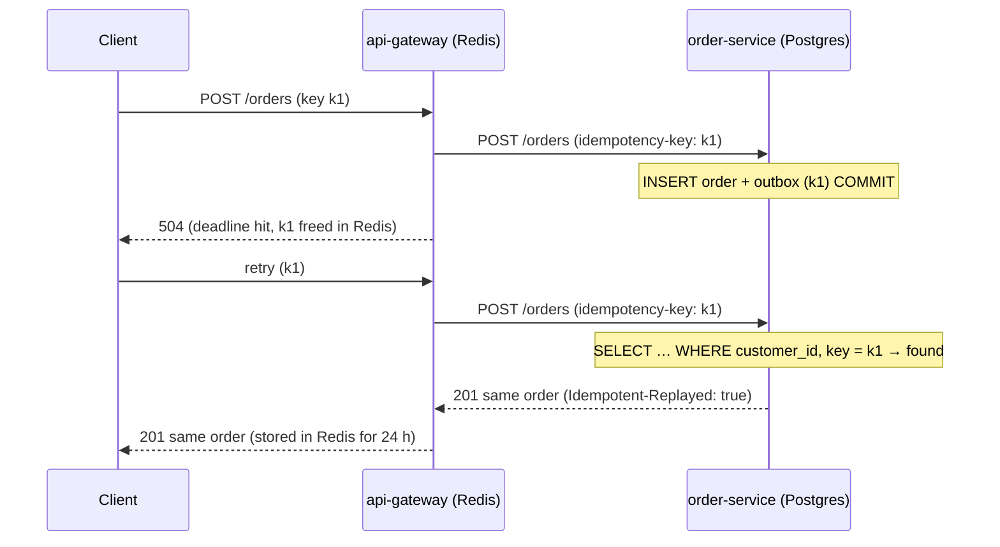

# 23. End-to-end idempotency: the data owner enforces the key

**In plain words.** #19 made retries safe at the gateway: Redis remembers each
`Idempotency-Key` and replays the first answer. But a gateway can't know what happened
behind a timeout. If order-service commits the order and answers after the 3 s deadline,
the gateway returns 504 and frees the key, and the retry used to create a **second
order**. Now the gateway forwards the key, and order-service stores it in a column with
`UNIQUE(customer_id, idempotency_key)`. A repeat gets the existing order back. Only the
service that owns the data can promise "at most once".

**Two layers, two jobs.**

| Layer                       | Stops                                         | Can't stop                         |
| --------------------------- | --------------------------------------------- | ---------------------------------- |
| Gateway (Redis, #19)        | fast replays, 409 while in flight, 422 misuse | anything after it gave up (504)    |
| order-service (UNIQUE, #56) | every duplicate, even after a timeout or race | nothing: it is the source of truth |

**How the repository does it.**

1. **Fast path:** `SELECT` by (customer, key). If found, return it with no transaction.
2. **Insert** order, items and outbox row in one transaction, with the key.
3. **Race:** two requests both miss step 1. The database lets exactly one INSERT win.
   The loser gets a unique violation (`P2002`), its whole transaction rolls back
   (including its outbox row, so no second `order.created`), and it returns the
   winner's order.

The lookup is an optimisation; **the constraint is the guarantee**. That's the same
"check-then-act needs an atomic backstop" lesson as the conditional UPDATE in the saga
(#13) and `ON CONFLICT DO NOTHING` for consumers (#11).

**Decisions (Syed's choices).** A column on `orders`, not a separate keys table: the key
lives as long as the order, needs no cleanup and is one index. Same key with a different
body → the existing order is returned. The gateway already answers 422 in the normal
path; after a 504 a changed body under one key is a client bug. Postgres treats NULLs as
distinct in a unique index, so orders without a key never collide. Keys are per
customer, and `customerId` is the JWT `sub` (#53), so two users can't collide or replay
each other's orders.

**Migration note.** Adding a nullable column is metadata-only in Postgres (instant).
`CREATE UNIQUE INDEX` blocks writes while it builds. On a large live table you'd use
`CREATE UNIQUE INDEX CONCURRENTLY` in its own migration (it can't run inside a
transaction).

**.NET equivalent.** EF Core: `HasIndex(o => new { o.CustomerId, o.IdempotencyKey })
.IsUnique()`. Catch `DbUpdateException` whose inner `PostgresException.SqlState ==
"23505"` and load the existing row. The gateway forwards the header with a YARP request
transform.

## Interview questions

1. **Your gateway already deduplicates. Why do it again in the service?**
   The gateway only knows about answers it saw. After a timeout the downstream may have
   committed, so the retry looks new to the gateway. Exactly-once effects need the
   system of record to enforce the key, atomically with the write.
2. **Two identical requests arrive at the same millisecond. What happens?**
   Both miss the lookup and both try to INSERT. The unique index lets one commit; the
   other gets a unique violation, its transaction (order + outbox) rolls back, and it
   reads and returns the winner's order. Never rely on check-then-insert alone.
3. **How would you add a unique index to a 500-million-row orders table in production?**
   `CREATE UNIQUE INDEX CONCURRENTLY` in its own non-transactional migration, monitored,
   and retried if it leaves an invalid index. Then attach it as a constraint if needed.
   Add the column as nullable first (metadata-only), backfill if needed, then add the index.
