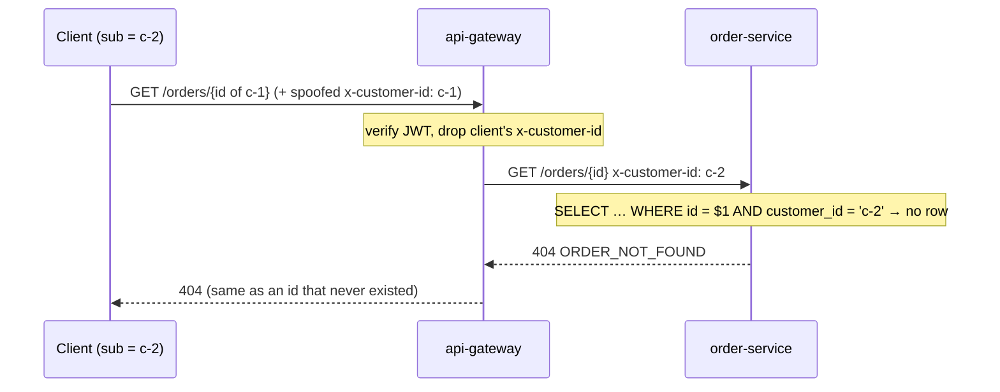

# 24. Ownership on reads: authorization lives in the WHERE clause

**In plain words.** Being logged in proves _who_ you are. It doesn't prove that order
`0b8f…` is _yours_. Before #61, any valid token could read any order by id, and
`GET /orders` listed everyone's orders. That is **BOLA** (Broken Object Level
Authorization, OWASP API Security #1, also called IDOR). Now the gateway sends the
verified JWT `sub` as `x-customer-id`, and order-service puts it in the query:
`WHERE id = ? AND customer_id = ?`. There's no "load, then check" step to forget.

**Why each choice.**

| Choice                                          | Why                                                                                                         |
| ----------------------------------------------- | ----------------------------------------------------------------------------------------------------------- |
| Filter in SQL, not after loading                | one query, and no code path returns the row before the check runs                                           |
| **404**, not 403, for someone else's            | 403 confirms the id exists; 404 gives an attacker nothing to enumerate                                      |
| 401 when the header is missing                  | fail closed: a direct call must never fall back to "all orders"                                             |
| Header set from the token only                  | it isn't in the forward allowlist, so a client copy is dropped                                              |
| `customerId` required in `DownstreamRequest`    | the compiler stops any `/orders` call that has no identity                                                  |
| Index `(customer_id, created_at DESC, id DESC)` | matches the list's WHERE + ORDER BY: a range read, no sort; it replaces the old `(customer_id, created_at)` |

**Trust boundary (Syed's choice: trusted header).** order-service believes
`x-customer-id` because only the gateway can reach it. That holds once a Kubernetes
NetworkPolicy enforces it (M5); until then it's a documented gap. The zero-trust
alternative is to forward the JWT and verify it in every service: stronger, but each
service then needs the key and its own auth setup.

**The cache is safe too.** Its key is `order-cache:{sub}:{orderId}`, and only 200s are
stored, so a 404 for another customer is never cached or served to anyone else.

**.NET equivalent.** In ASP.NET Core, `User.FindFirst("sub")` in the service layer, plus
an EF Core **global query filter** (`HasQueryFilter(o => o.CustomerId == _tenant.Id)`) so
every query is scoped by default. That's the same "make the safe thing the default" idea.
Resource-based authorization (`IAuthorizationService.AuthorizeAsync(user, order, …)`) is
the load-then-check alternative.

## Interview questions

1. **Our ids are UUIDs and can't be guessed. Isn't that enough?**
   No. Ids leak through logs, URLs, emails, referrers and support tickets. Unguessable
   ids reduce the risk; only an ownership check removes it. Treat every id from a client
   as untrusted input.
2. **403 or 404 for another user's resource?**
   404, when existence itself is sensitive (orders, documents), so attackers can't tell
   "exists but not yours" from "doesn't exist". 403 fits when the resource is known to
   exist and the user just lacks a permission (e.g. a read-only admin).
3. **Where should the check live: gateway or service?**
   In the service that owns the data, inside the query. The gateway proves identity and
   passes it on; it can't filter a list it doesn't own, and checking a response after
   the fact means the data was already read. Defence in depth: the service also refuses
   requests with no identity (401).
