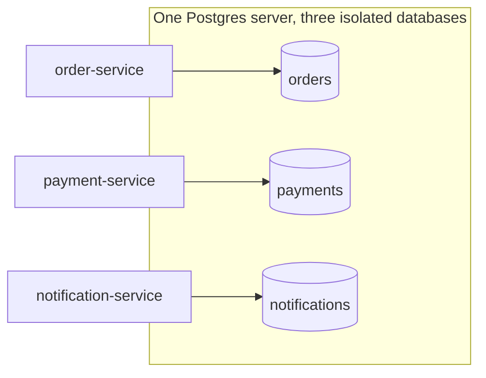

# 27. A new service and its own database

**In plain words.** notification-service gets what every ShopFlow service has:

- validated config (fail fast)
- liveness and readiness checks
- graceful shutdown
- **its own database**: a `notifications` role that owns a `notifications` database,
  with no CONNECT for anyone else

It reads nothing from `orders` or `payments`. Everything it needs will arrive in the
payment events (#14). The only table, `notifications`, has two jobs: the **dedupe key**
(UNIQUE `event_id`) and the **audit log** of what each customer was told, and when.

**Why one server but separate databases and roles?** Database-per-service is about
**ownership**, not hardware. Each service can change its schema freely, and no other
service can quietly join against its tables, because its role can't even connect.
Locally, one Postgres keeps things light. In production each database can move to its
own server without a code change, since only the connection string differs.

**"A row exists if and only if the notification went out."** In #14 the consumer will
insert the row and send inside one transaction:

- If the send fails, the insert rolls back and Kafka retries.
- If the event is redelivered after a successful commit, the UNIQUE constraint stops a
  second notification.

The remaining window is a crash after sending but before committing. That means a
duplicate, never a lost notification. At-least-once delivery means duplicates are
possible; we make them rare and harmless.

**CHECK constraints by hand.** Prisma can't express them, so the migration adds them:
known `event_type`, known `channel` (`log` for now) and a non-blank `message`. The
database is the last line of defence against a bug in any code path.

**Liveness ≠ readiness (checked against the built app).** With the database
unreachable, `/health` is 200 (don't restart me) and `/health/ready` is 503 (don't
send me traffic). A bad `NOTIFICATION_DATABASE_URL` stops startup and names the
variable without printing its value.

**.NET equivalent.** A new ASP.NET Core worker service with `IOptions<T>` +
`ValidateOnStart()`, `AddHealthChecks().AddNpgSql(...)` mapped to two endpoints with
different predicates, its own `DbContext` and EF migrations, and a SQL login per
service database.

## Interview questions

1. **Database-per-service with one Postgres server: isn't that cheating?**
   No. The rule is about ownership and coupling, not machines. Separate databases plus
   separate roles (CONNECT revoked) give each service a private schema. Splitting onto
   separate servers later is an ops decision about scale and blast radius.
2. **Why store sent notifications at all? Just log them.**
   You need a dedupe key that survives restarts and works across replicas, and support
   needs to answer "did we tell the customer?". One table with UNIQUE `event_id` does
   both.
3. **Can a notification be sent exactly once?**
   Not across a network. The send and the database commit can't be atomic, so one is
   always first. We choose at-least-once (insert and send in one transaction) and accept
   a rare duplicate. For real email or SMS, pass the `eventId` as the provider's
   idempotency key so they deduplicate too.
