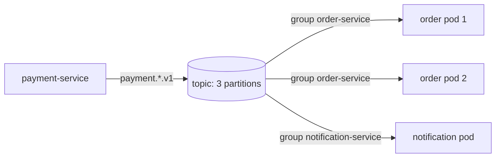

# 28. Fan-out with consumer groups, and ports and adapters

**In plain words.** order-service and notification-service both read
`payment.succeeded.v1` and `payment.failed.v1`, and each gets **every** event. Kafka
doesn't remove a message when someone reads it. It keeps a **committed offset per
consumer group** (a bookmark per partition), so each group reads independently. Inside
one group the partitions are shared out: two order-service pods split the work, they
don't both process the same event.

| Same group                           | Different groups                      |
| ------------------------------------ | ------------------------------------- |
| work queue: each event to one member | pub/sub: each event to every group    |
| scale a service out                  | add a new service, producer untouched |

Adding notification-service changed **no other service**. That's the payoff of
publishing facts (events) instead of calling services directly.

**Ports and adapters (hexagonal).** `NotificationsService` depends on a port,
`NotificationSender` (`channel` + `send`). `LogNotificationSender` is the adapter today.
An email adapter would be a new class plus one line in `NotificationsModule`. The logic,
the dedupe and the tests stay untouched. Nest has no runtime interfaces, so the port is
injected by a token (`NOTIFICATION_SENDER`).

**At most once per event, at least once overall.** The repository inserts the row, calls
`send()`, then commits:

| Situation                           | Result                                       |
| ----------------------------------- | -------------------------------------------- |
| send throws                         | row rolled back → Kafka retries → sent later |
| event redelivered after commit      | UNIQUE(event_id) → `duplicate`, no send      |
| two pods get the same event at once | second insert waits on the index → duplicate |
| crash after send, before commit     | sent twice (the unavoidable window)          |
| malformed event                     | ContractViolationError → DLQ at once         |

The send runs **inside** the transaction, so it has a 10 s timeout. A hanging provider
must fail and retry, not hold a row lock. For a slow real provider you would instead
record PENDING, commit, send, and mark SENT (or use an outbox).

**.NET equivalent.** Confluent.Kafka consumers with different `GroupId`s (or MassTransit
endpoints, each with its own queue). Ports and adapters is an `INotificationSender` with
`services.AddScoped<INotificationSender, LogNotificationSender>()`.

## Interview questions

1. **Two services consume the same topic. How do consumer groups make that work?**
   Each group has its own offsets, so each group sees every event: pub/sub between
   groups, a work queue within a group. Parallelism inside a group is capped by the
   partition count.
2. **What happens if both services used the same group id?**
   They would split the partitions, and each event would reach only one of them. Half
   the orders would never be marked paid, or half the customers never notified. A
   group id names a logical consumer, not a process.
3. **Why ports and adapters for a log line?**
   The business rule ("notify once per payment result") is tested without any
   provider, and swapping or adding channels doesn't touch it. It's cheap here: one
   interface and one token.
