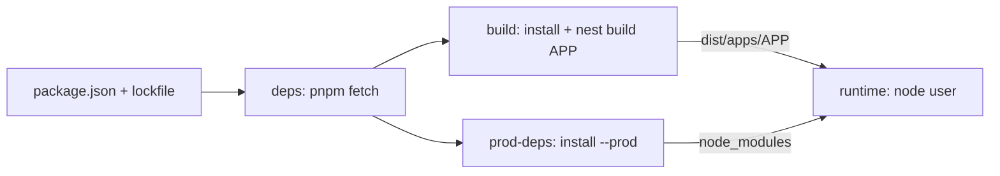

# 29. Multi-stage Docker images: small, cached, least privilege

**In plain words.** Building a NestJS app needs a lot (pnpm, TypeScript, the Nest and
Prisma CLIs, Jest types). Running it needs far less: Node, the compiled JavaScript and
the production packages. A multi-stage Dockerfile does the heavy work in throwaway
stages, and only the last stage becomes the image you ship.

**Three ideas.**

| Idea            | How we do it                                                                | Why                                                          |
| --------------- | --------------------------------------------------------------------------- | ------------------------------------------------------------ |
| Layer caching   | `deps` copies only the manifests; a BuildKit cache mount keeps pnpm's store | a code edit reuses the dependency layer: rebuilds in seconds |
| Small image     | runtime = alpine + `dist/apps/<APP>` + prod `node_modules`                  | less to pull, less to scan, fewer CVEs to patch              |
| Least privilege | `USER node`; files owned by root (read-only for the app)                    | a compromised process can't write its own code or bind <1024 |

**Details that matter.**

- **Pinned tag** (`node:26.13.1-alpine3.24`): the same build gives the same image. A
  floating `node:26` can change under you. Pinning by digest is stricter still.
- **`exec node`** in CMD: node becomes PID 1 and receives SIGTERM directly, so Nest's
  shutdown hooks run. Without `exec`, the shell gets the signal and the app is killed
  after the grace period, mid-request.
- **Secrets stay out:** `.dockerignore` excludes every `.env*`. Image layers are
  forever: a secret copied in and deleted in a later layer is still in the image.
- **No migrations in the app image:** run `prisma migrate deploy` as a separate job (a
  compose one-shot or Kubernetes Job) before rollout, so three replicas don't race to
  migrate.
- **One recipe, four images:** every service builds the same way, so one file is
  hardened once. The image only differs by `APP`.

**.NET equivalent.** The standard `mcr.microsoft.com/dotnet/sdk` → `dotnet publish` →
`mcr.microsoft.com/dotnet/aspnet` multi-stage Dockerfile, with `USER app` (the non-root
user .NET 8+ images ship) and `COPY *.csproj` + `dotnet restore` first for caching.

## Interview questions

1. **Why multi-stage?** Build tools and sources stay out of the final image: it's
   smaller, faster to pull and has less attack surface. One Dockerfile still describes
   the whole build, reproducibly.
2. **Why non-root?** Defence in depth. A container escape or an RCE as root is far
   worse, and many clusters reject root pods (Pod Security "restricted"). Our ports are
   above 1024, so root buys nothing.
3. **How do you keep image builds fast in CI?** Order layers from least to most often
   changed (manifests → install → source). Use BuildKit cache mounts for the package
   store, and a registry or GitHub Actions layer cache (`cache-from` / `cache-to`) so CI
   runners reuse layers between runs.
