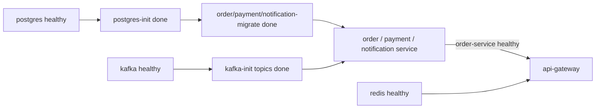

# 30. Startup ordering and health-gated dependencies

**The concept.** A distributed system starts in a fixed order. The database has to accept
connections, the schema has to exist, and the topics have to exist before a service can do
useful work. Compose lets each service wait on a _condition_ of another one:
`service_started` (the process exists, which tells you little), `service_healthy` (its
healthcheck passes) or `service_completed_successfully` (a one-shot job exited 0).

**Why we did it this way.**

- **Migrations are separate one-shot jobs.** The app doesn't migrate itself on boot. Two
  replicas that both run `migrate deploy` at startup race each other. The app image would
  also need the Prisma CLI and DDL rights. A separate `migrate` image runs once per
  database. In Kubernetes the same image becomes a Job (or a Helm pre-upgrade hook).
- **Healthchecks use readiness (`/health/ready`).** A service only counts as healthy once
  its database answers, so the gateway starts after order-service can really serve.
- **`depends_on` only covers the first start.** If Postgres or Kafka dies later, nothing in
  compose stops or restarts the apps. Runtime resilience is the app's job. Readiness turns
  503, the outbox relay retries with backoff, and consumers reconnect (`runInBackground`).
  `restart: unless-stopped` covers a crashed process. Kubernetes has no `depends_on`
  at all, so we built these app-side mechanisms first.
- **Fail fast on missing config.** `${JWT_SECRET:?...}` stops `compose up` before anything
  starts. It's the compose equivalent of our env validation at boot.

**.NET equivalent.** .NET Aspire's `WaitFor(db)` / `WaitForCompletion(migrator)` does the same
thing as `depends_on` conditions. The EF Core advice matches too: use a migration bundle
(`dotnet ef migrations bundle`) or a separate migrator project instead of
`Database.Migrate()` in `Program.cs` on every instance. Health checks map to
`AddHealthChecks()` with separate liveness/readiness tags.

## Interview questions

1. **Is `depends_on` enough for resilience?**
   No. It only orders container _startup_ on one host. A dependency can go down at any time
   later, and Kubernetes has no such feature. Services must tolerate a missing dependency
   with retries plus backoff, readiness that reports 503, and circuit breakers. Ordering
   just avoids a noisy crash loop at boot.

2. **What should a service do when a dependency is down at start?**
   Start anyway when it can and report _not ready_. Then the orchestrator keeps traffic away
   while background connections retry (our Kafka consumers do this). Only missing _config_
   should crash it (fail fast), because retrying doesn't fix a wrong config.
   Crash-looping on a down database just adds restart churn and log noise.

3. **Why not run migrations when the app starts?**
   With N replicas, N processes race the same DDL. Some tools take a lock, but a slow
   migration then blocks every pod's startup and trips liveness probes. The app would also
   need schema-change privileges at runtime. A one-shot job runs once, has its own
   credentials, and fails visibly. The usual rule is that migrations stay
   backward-compatible (expand/contract), so old and new app versions can both run against
   the new schema during a rolling deploy.
