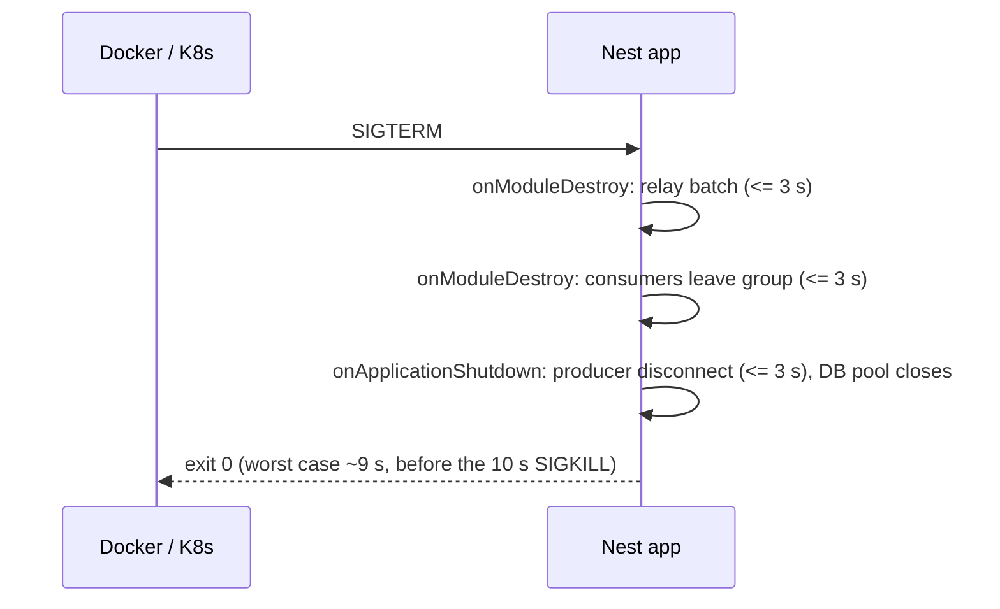

# 31. Bounded graceful shutdown

**The concept.** Graceful shutdown means that on SIGTERM a process stops taking new
work, finishes or hands back the work in flight, and closes its connections. The
orchestrator doesn't wait forever, though. Docker sends SIGKILL after 10 s and Kubernetes
after `terminationGracePeriodSeconds` (30 s by default). So graceful shutdown needs a
**budget**. Each step gets a deadline, and a step that misses it is abandoned so the
following steps (closing the DB pool) still run.

The bug (#72): with Kafka unreachable, each hook waited on a promise that kafkajs kept
retrying. The consumer disconnect waited on a connect still in progress, the relay batch
was stuck in `send`, and the producer disconnect came last. Docker killed the process
(exit 137).

**Why it is safe to give up.** We already rely on at-least-once delivery. An offset that
isn't committed is redelivered, and the processed-events table dedupes it. An outbox row
that isn't marked published is sent again after the restart, because its transaction
rolls back when the pool closes. Abandoning a step costs a duplicate, never a loss. The
producer also rejects new sends once shutdown starts, so nothing opens a fresh retry loop.

**.NET equivalent.** `HostOptions.ShutdownTimeout` (30 s by default in .NET 6+) is the
same budget. `IHostedService.StopAsync(CancellationToken)` receives a token that fires
when time is up. Our `settleWithin(work, ms)` plays the role of
`await task.WaitAsync(timeout)` inside `StopAsync`, without throwing on timeout.

## Interview questions

1. **What happens between SIGTERM and SIGKILL in Kubernetes?**
   The pod goes into Terminating and is removed from Service endpoints. Any preStop hook
   runs, then SIGTERM is sent. After `terminationGracePeriodSeconds`, SIGKILL follows. The
   app should stop accepting work, drain in-flight work, commit offsets and close pools
   within that window. Endpoint removal is eventually consistent, so a short preStop sleep
   is common.

2. **Your shutdown hangs when a dependency is down. How do you fix it without losing data?**
   Put a deadline on every shutdown step and keep the total under the grace period. Make
   abandoning safe through the delivery design: idempotent consumers and an outbox. Then a
   step cut short only causes a redelivery, never a lost or half-applied write.

3. **Why does PID 1 matter for graceful shutdown in a container?**
   Signals go to PID 1. If a shell is PID 1 and doesn't forward SIGTERM, the app never
   hears it and is SIGKILLed after the grace period. That's why our Dockerfile uses
   `exec node`. PID 1 also has no default signal handlers, so the app must install its own
   (Nest's `enableShutdownHooks`).
