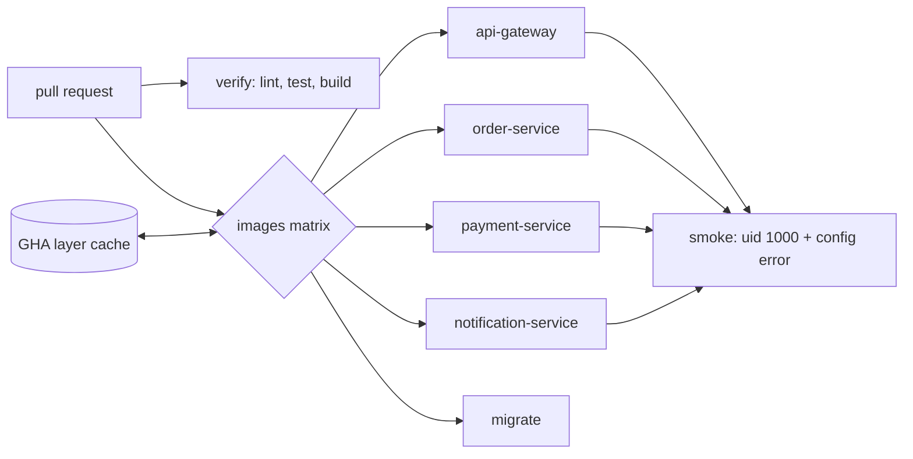

# 32. Building images in CI: matrices and layer caching

**The concept.** A Dockerfile is code. It breaks like code: a renamed file, a
`.dockerignore` rule that hides something, a package that only exists as a dev dependency.
`pnpm build` on the host can't see any of this. Only building the image can. So CI builds
every image on every PR.

- **Build matrix.** One job definition fans out into parallel jobs, one per image. We use
  `fail-fast: false`, so a broken payment-service image still tells you whether the other
  four are fine.
- **Layer cache.** Docker caches each layer by its inputs. CI runners start empty, so
  buildx exports the cache to the GitHub Actions cache (`type=gha`) and imports it on the
  next run. There is one `scope` per image, so the five builds don't overwrite each other.
  `mode=max` also caches the intermediate stages (deps, build), which are the slow ones.
  The order of our Dockerfile layers (lockfile first, source later) is what makes the
  cache hit.
- **Smoke test, not just build.** A successful build only proves the recipe runs. We also
  start each image without config. It must load every module and stop at our fail-fast
  config error. A missing production dependency would crash earlier with
  `Cannot find module`.

**.NET equivalent.** It's the same idea as a `docker build` step per project in Azure
DevOps or GitHub Actions for ASP.NET Core images, with a strategy matrix. The .NET SDK can
also build images without a Dockerfile (`dotnet publish /t:PublishContainer`). Caching
`~/.nuget/packages` plays the role of our pnpm store and layer cache.

## Interview questions

1. **How would you version and promote images across environments?**
   Build once and tag with the immutable git SHA (plus semver on release tags). Push to a
   registry, then promote _the same digest_ from dev to staging to prod by changing which
   tag or digest each environment's manifests point to (GitOps). Never rebuild per
   environment: the artifact you tested is the one you ship. Config comes from the
   environment, not the image.

2. **How do you keep Docker builds fast in CI?**
   Order layers from least to most frequently changed. Persist the layer cache between
   runs (registry or GHA cache, `mode=max` for multi-stage). Use cache mounts for package
   stores, a tight `.dockerignore`, and parallel builds per image.

3. **Why build images in CI if you don't push them?**
   It catches Dockerfile breakage at PR time, when the author still has context, instead
   of at deploy time. The smoke test also catches runtime problems the compiler can't
   see, such as missing production dependencies, running as root, or a wrong entrypoint.
