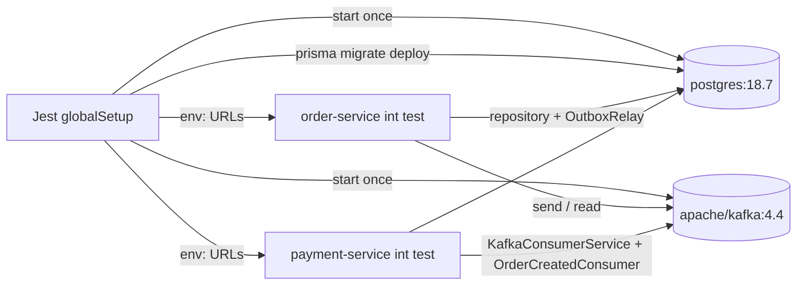

# 33. Integration tests with Testcontainers

**The concept.** Unit tests mock the database and the broker. They're fast and pin down
_our_ logic, but a mock only knows what we told it. Integration tests run the real
dependency in a throwaway container. Testcontainers starts it from the test code, waits
until it's ready, maps a random port, and removes it afterwards (its Ryuk sidecar cleans
up even after a crash).

**What our tests cover that the unit tests can't.**

- **Atomicity.** An order rejected by a CHECK constraint leaves no outbox row behind. Only
  a real Postgres transaction can prove that.
- **The outbox relay end to end.** The row goes to Kafka keyed by order id, is marked
  published, and is never sent twice.
- **Idempotent consumer.** The same `order.created` delivered twice through real Kafka
  gives one payment and one result event. A malformed message goes straight to `.dlq`.
- **Real-system behaviour.** These tests found two things the mocks hid. A fresh broker
  has no group coordinator for a few seconds. And `consumer.disconnect()` waits for a
  kafkajs fetch long-poll (up to 5 s), which is the root cause of the slow shutdown in
  #77.

**Keeping them fast.** The containers start **once per run** in `globalSetup`, not once
per test (about 10 s saved per file). Tests isolate themselves by data (their own order
ids and consumer groups) instead of restarting containers. We use the same images as
compose, so there's no "works with a different version" surprise. They're a separate
command (`pnpm test:int`) and a separate CI job, so lint and unit feedback stays quick.

**.NET equivalent.** `Testcontainers` for .NET (`PostgreSqlBuilder`, `KafkaBuilder`) with
an xUnit `IAsyncLifetime` class fixture or collection fixture, which plays the role of our
`globalSetup`. It's often combined with `WebApplicationFactory` for API-level tests.

## Interview questions

1. **Why not mock the database in integration tests?**
   The bugs that matter live in the integration: SQL syntax, constraints, transaction
   isolation, migrations, serialization, client-library behaviour (for example, how
   kafkajs disconnects). An in-memory fake (EF InMemory, SQLite) behaves differently
   from Postgres. A mock just repeats your assumptions back to you.

2. **How do you keep integration tests fast and reliable?**
   Start containers once per run and reuse them. Isolate by data (unique ids, topics,
   groups) or truncate between tests. Wait on real readiness (log line, health check,
   polling with a deadline), never on a fixed `sleep`. Pin image versions. Keep the
   suite small and focused on boundaries; the pyramid stays wide at the unit level.

3. **Where do integration tests sit in the test pyramid, and why not test everything
   end to end?**
   In the middle. Many unit tests for logic, fewer integration tests per boundary (DB,
   broker, HTTP client), and very few E2E tests through the whole system. E2E tests are
   slow, flaky and hard to debug: a failure says "something broke" but not where.
