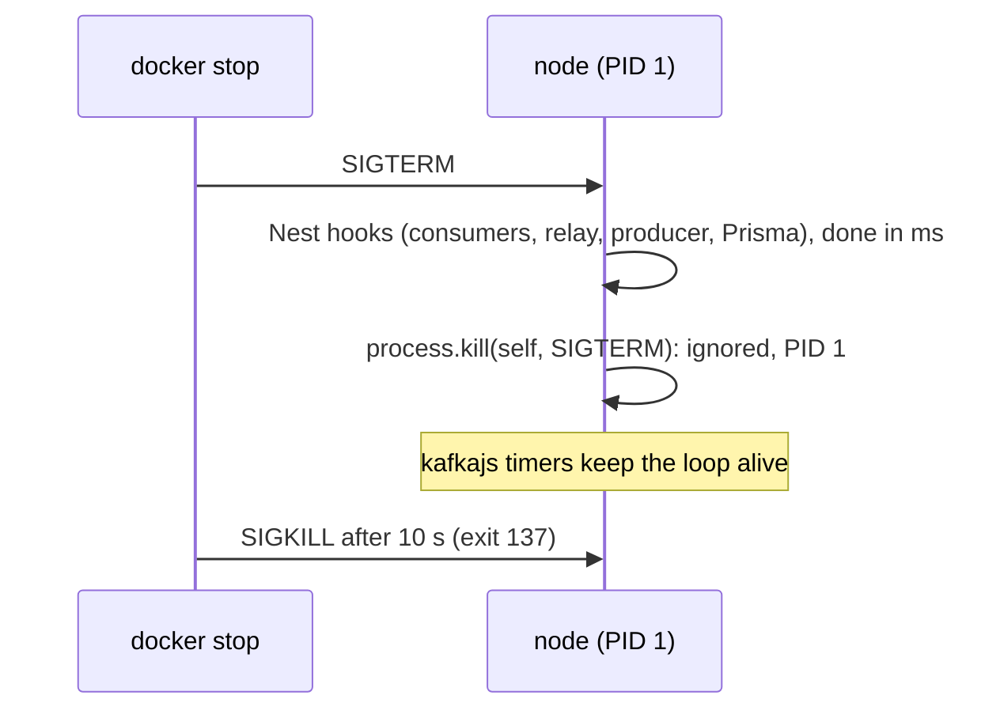

# 34. PID 1 and signals in containers

**The concept.** In a container, the main process is **PID 1**, and Linux treats PID 1
specially: a signal whose action is "default" (for SIGTERM, "terminate") is **ignored**.
Only signals the process installed a handler for do anything. On a normal host the
kernel would just kill the process.

**The bug (#77).** Nest's `enableShutdownHooks()` installs a SIGTERM handler, runs our
hooks, removes the handler, and then **re-raises** SIGTERM (`process.kill(pid, signal)`)
so the default action ends the process. As PID 1, that re-raise does nothing. The
process then only exits if the event loop happens to be empty. With Kafka down, kafkajs
keeps reconnect and "restarting the consumer" timers alive, so the process lived on
until Docker's SIGKILL at 10 s (exit 137). Instrumenting the hooks showed all of them
finished in 5 ms. **No hook was slow; the process just never exited.**

**The fix.** `enableShutdownHooks([], { useProcessExit: true })` makes Nest call
`process.exit(0)` after the hooks. It works the same on a laptop, in Docker and in
Kubernetes, so there's no PID 1 special case to remember.

A second, smaller fix: kafkajs consumers long-poll for up to **5 s** (`maxWaitTimeInMs`),
and `disconnect()` waits for that poll. We now use **500 ms**, the Java client's default
`fetch.max.wait.ms`. With Kafka up, a stop now takes under 1 s instead of about 3 s.

**Why the tests missed it.** The unit tests mock kafkajs. `app.close()` in a test never
re-raises a signal, and the test runner isn't PID 1. Only the live `docker stop` check
showed it. The new integration test guards the part that tests _can_ see: the time
the hooks take, with Kafka up and with Kafka gone.

**Other common fixes.** `docker run --init` / compose `init: true` puts `tini` in front
as PID 1, which forwards signals and reaps zombies. Many images use `dumb-init`.
Kubernetes has no `--init`, so fixing it in the app is the portable choice.

**.NET equivalent.** The ASP.NET Core generic host handles SIGTERM itself
(`ConsoleLifetime`). It runs `IHostedService.StopAsync` within `HostOptions.ShutdownTimeout`
(30 s by default since .NET 8) and then returns from `Main`. So the process exits on its
own, never relying on the default signal action.

## Interview questions

1. **Why does a process sometimes ignore `docker stop` and get killed after 10 s?**
   It's PID 1, and PID 1 has no default signal actions. Either it doesn't handle SIGTERM
   at all, or it's started via `sh -c` without `exec` (the shell is PID 1 and doesn't
   forward the signal), or its handler doesn't actually exit. Fix: exec form or `exec`,
   handle SIGTERM and exit explicitly, or use an init (`tini`).

2. **What happens to Kafka consumers when a pod is SIGKILLed instead of stopped cleanly?**
   No LeaveGroup is sent, so the broker keeps the dead member until the session times out.
   Its partitions sit idle and the next instance waits to join the group. We saw a
   20 s rejoin after an abandoned stop. Uncommitted messages are redelivered, which is
   safe only because consumers are idempotent.

3. **How would you test graceful shutdown?**
   Unit-test each step's logic and bounds. Run an integration test with real Kafka that
   stops the broker and asserts that `close()` returns within budget. Do a live
   `docker stop` (or a pod delete) to check exit code 0 and duration, because PID 1 and
   signal behaviour only show up there.
