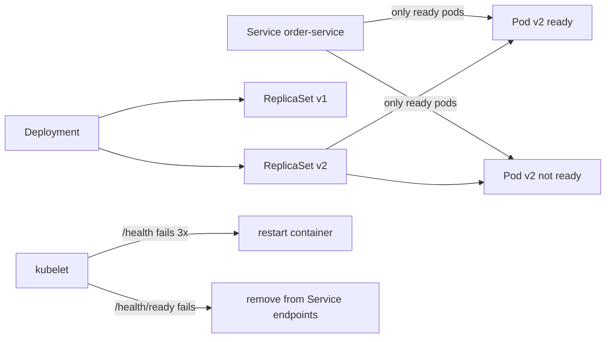

# 35. Kubernetes: Deployments, Services, probes and resources

**The concept.** A **Pod** is one running instance (our container). A **Deployment** keeps
N pods of one version running and replaces them gradually on a change (rolling update,
through a ReplicaSet per version). A **Service** gives the pods one stable DNS name
(`order-service:3001`) and load-balances to the pods that are **ready**. A **ConfigMap**
holds settings and a **Secret** holds credentials. Both reach the app as environment
variables, so the 12-factor config from compose carries over unchanged.

**Our choices.**

- **Liveness = `/health`** (the process answers). **Readiness = `/health/ready`**
  (Postgres reachable). We saw it live: with no database yet, the pods ran for minutes
  with 0 restarts but never received traffic. If liveness checked the DB, a database
  outage would restart-loop every pod and make it worse.
- **The gateway's readiness ignores downstream services.** Otherwise one slow
  order-service would pull every gateway pod out of the load balancer.
- **Requests** (what the scheduler reserves) come from measured idle memory
  (55–130 MiB). **Limits**: above the memory limit the container is OOMKilled; above
  the CPU limit it's only throttled.
- **Hardening:** non-root uid 1000, read-only root filesystem (an `emptyDir` for `/tmp`),
  all capabilities dropped, no service-account token (the app never calls the API).
- **Secrets** are generated from gitignored files (`secretGenerator`). The content hash in
  the name means a changed secret rolls the pods. One Secret per app, so a service sees
  only its own credentials.
- **Rolling update safety:** new pods that never become ready don't replace old ones.
  The Deployment waits, so a broken release doesn't take the working one down.

**.NET equivalent.** ASP.NET Core health checks with tags:
`MapHealthChecks("/health/live", new() { Predicate = _ => false })` for liveness and a
`ready`-tagged DB check for readiness. The Kubernetes side is identical. Requests and
limits matter extra for .NET because GC heap sizing follows the container memory limit
(Server GC), much like Node sizing its heap from the cgroup limit.

## Interview questions

1. **What happens when a readiness probe fails vs a liveness probe?**
   Readiness: the pod is removed from the Service endpoints (no traffic) and keeps
   running; it comes back when the probe passes. Liveness: the kubelet kills and restarts
   the container. So liveness checks only "am I stuck"; dependencies belong in
   readiness, or a dependency outage turns into a restart storm.

2. **Requests vs limits?**
   Requests are what the scheduler reserves and places the pod by. Limits are a hard
   cap: memory over the limit means OOMKill, CPU over the limit means throttling.
   Requests equal to limits gives the Guaranteed QoS class (evicted last). Many teams set
   memory limits but skip CPU limits to avoid throttling latency spikes.

3. **How do you keep secrets out of git with Kubernetes?**
   Never commit Secret manifests (base64 isn't encryption). Create them at deploy time
   from a local file or CI secret, as we do, or use Sealed Secrets, SOPS or External
   Secrets (Vault, cloud secret managers). Also enable etcd encryption at rest and keep
   RBAC on Secrets tight.
