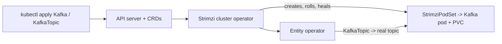

# 36. Operators, CRDs and StatefulSets

**The concept.** Kubernetes is a set of **controllers**. Each one watches objects and keeps
moving the real world towards the declared spec (the reconcile loop). A **CRD** (Custom
Resource Definition) adds a new object kind to the API, for example `Kafka` or
`KafkaTopic`. An **operator** is a controller for such a kind that encodes what a human
operator would do: create brokers, roll config changes one pod at a time, renew
certificates, create topics. We apply `kind: Kafka`; Strimzi turns it into pods,
Services, ConfigMaps and certificates, and puts them back if something drifts.

**What we saw live.**

- The Kafka/KafkaTopic kinds only exist after the operator's CRDs are registered. The
  first apply failed with "no matches for kind". So the script installs the operator
  first and waits for `Established`.
- **Strimzi 1.x serves only `kafka.strimzi.io/v1`.** Old `v1beta2` examples fail.
  Operators version their APIs like any other API.
- We deleted the Kafka pod and the operator recreated it in 23 s. Its owner is a
  `StrimziPodSet`, Strimzi's own replacement for StatefulSet: it can change brokers one
  by one and differently from each other, which a StatefulSet's identical template can't.
- Topics are declared (`KafkaTopic`), replacing compose's imperative `kafka-init`. They're
  reviewed in a PR and reconciled back if someone changes them by hand.

**StatefulSets** (our Postgres): stable pod names (`postgres-0`), a stable DNS name via a
headless Service, and a PersistentVolumeClaim per pod from `volumeClaimTemplates`. That
volume survives restarts and rescheduling, while a Deployment's pods are interchangeable
and stateless. Redis stays a Deployment on purpose: its data is disposable, as in compose.

**Jobs instead of depends_on.** Kubernetes has no start order. `postgres-init` simply
failed twice until Postgres was up, then succeeded (retry with backoff). The migration
Jobs do the same, and the apps' readiness keeps traffic away meanwhile. "Retry until the
dependency is there" is the Kubernetes way, and it also covers dependencies that go
down later.

**.NET equivalent.** The operator pattern is the same in any language (the official C# client
and KubeOps exist). For migrations, the counterpart of our Job is an EF Core migration
bundle (`dotnet ef migrations bundle`) run as a Job or init container, never at app
startup with several replicas racing.

## Interview questions

1. **Why an operator for Kafka instead of a plain StatefulSet?**
   Kafka needs Day-2 knowledge: rolling restarts one broker at a time while keeping
   partitions in sync, KRaft quorum handling, per-broker config, listener and TLS
   certificate management, topics and users as code, upgrades. An operator automates
   that and reconciles drift; a StatefulSet only keeps N identical pods running.

2. **Would you run databases in Kubernetes in production?**
   It depends. Managed services (RDS, Cloud SQL, Azure Database) give backups, PITR,
   failover and patching without effort, so they're the default for most teams. In
   Kubernetes it's viable with a mature operator (CloudNativePG, Strimzi), solid storage
   classes, tested backups and a team that owns it. A bare StatefulSet like ours is fine
   for dev and test only.

3. **What does a StatefulSet give you that a Deployment doesn't?**
   Stable network identity (pod-0, pod-1 with their own DNS names), a dedicated
   PersistentVolumeClaim per pod that follows it, and ordered start, stop and rolling
   updates. You need it for clustered or stateful software where each replica is
   different.
