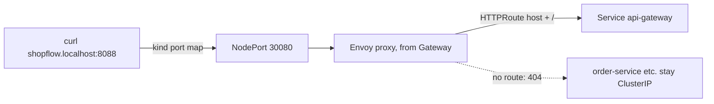

# 37. Exposing services: NodePort, LoadBalancer, Ingress and the Gateway API

**The concept.** A **ClusterIP** Service (all of ours) is reachable only inside the
cluster. To let outside traffic in, there are three levels:

- **NodePort** opens the same port (30000–32767) on every node. It's raw, one port per
  service, with no hostnames or paths. We use it only as kind's stand-in for a load
  balancer.
- **LoadBalancer** asks the cloud for an external load balancer and IP, one per Service.
  That's simple, but you pay per LB and get no HTTP routing.
- **Ingress / Gateway API** is one shared L7 entry point (a proxy such as Envoy) that routes
  by host and path to many ClusterIP Services, and terminates TLS. That's the standard
  front door.

**Why the Gateway API and not Ingress.** ingress-nginx, the usual Ingress controller, was
archived in March 2026 (ADR 0007). Ingress itself is frozen. Anything beyond host/path
needed controller-specific annotations, so it wasn't portable. The Gateway API splits the
object by role: **GatewayClass** (platform: which implementation), **Gateway**
(operator: listeners, ports, TLS) and **HTTPRoute** (app team: routes). Header matching,
weighted traffic splits and cross-namespace rules are part of the spec.

**What we saw live.** The demo ran from Windows against `http://shopflow.localhost:8088`.
A request with another Host header got a 404 from Envoy, and the LAN IP couldn't connect
(bound to 127.0.0.1). Only api-gateway is exposed: rate limiting, JWT and idempotency
still happen in our app, behind the edge.

**.NET equivalent.** YARP is the reverse-proxy library behind many ASP.NET Core gateways. In
Azure: Application Gateway for Containers (which implements the Gateway API) or Front Door
in front of AKS. Kestrel behind the proxy uses `ForwardedHeaders` middleware to see the
real client IP and scheme.

## Interview questions

1. **Ingress vs LoadBalancer vs NodePort?**
   NodePort: a port on every node, for debugging or as a building block. LoadBalancer:
   one cloud LB and IP per Service, L4. Ingress/Gateway: one L7 proxy for many services,
   with host/path routing and TLS, usually behind a single LoadBalancer. Production
   HTTP APIs normally use the last option.

2. **Where should TLS terminate?**
   Usually at the edge (Gateway/Ingress, certificates from cert-manager / Let's Encrypt):
   one place to manage certificates and inspect L7. Inside the cluster, either trust the
   network with NetworkPolicies, or re-encrypt with mTLS (a service mesh) when compliance
   or zero trust requires it. End-to-end passthrough only when the backend must hold the
   key.

3. **Ingress/Gateway vs an API gateway: do you need both?**
   The edge proxy is infrastructure: routing, TLS, basic limits. Our api-gateway is
   application logic: JWT validation, per-customer rate limits, idempotency keys,
   correlation IDs, response shaping. Many teams merge them, using Envoy filters or a
   managed API gateway. Keeping them apart makes the app logic testable in our code and
   portable.
